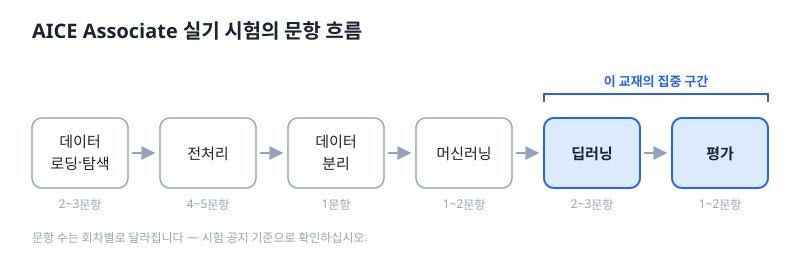
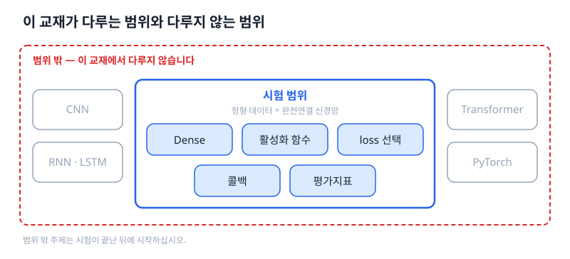
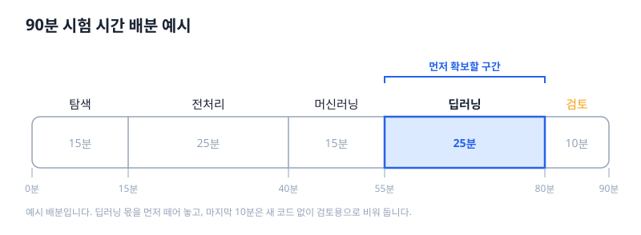
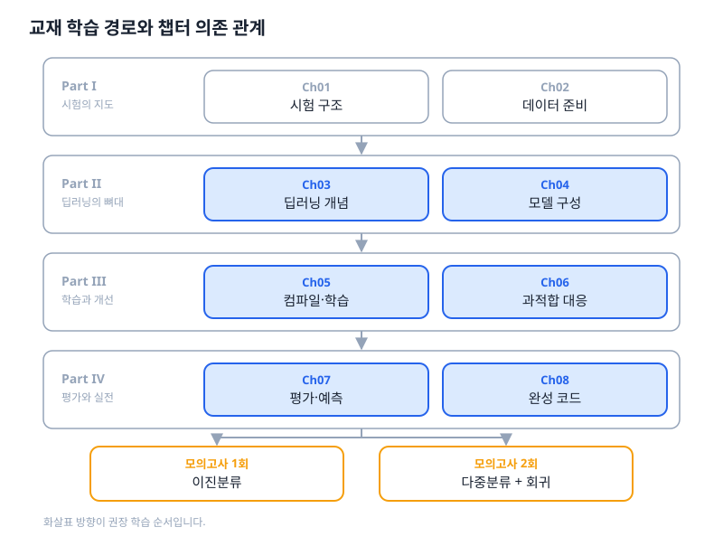

# 1회차 — AICE Associate 시험 구조와 학습 지도

- 범위: 1장 (https://newids.github.io/dl4aice/ch01.html)
- 발표 35분 안팎 + 질의응답 20분
- 사전 준비: 챕터 읽기 + 실습 셀 풀기 (https://newids.github.io/dl4aice/ch01.html#drills-ch01)

---

## 오늘의 목표

1. 시험의 문항 흐름(1~14번)과 합격 기준을 자기 말로 설명한다.
2. 어떤 주제가 시험 범위 안이고 밖인지 구분하고, 공부 순서를 정한다.
3. 90분을 단계별로 나누어 자기 마감 시각을 적는다.

---

## 진행 순서

| 구간 | 내용 | 시간 |
|---|---|---|
| 시험 형식과 문항 흐름 | 형식, 번호별 구간, 앞 문항 결과 이어받기 | 8분 |
| 범위와 문제 유형 | 범위 안팎, 유형 세 가지 | 5분 |
| 시간 배분과 답안 습관 | 시간표, 지시문 옮겨 쓰기, 자주 틀리는 지점, 첫 셀 | 9분 |
| 학습 경로와 사이트 활용 | 챕터 순서, 스터디에서 쓸 사이트 기능 | 5분 |
| 함께 풀기 | 실습 셀 두 문항 | 7분 |
| 정리 | 기억할 내용 정리 | 2분 |
| 질의응답 | 토론 질문과 질문 받기 | 20분 |

---

## 시험 형식의 기준선 (3분)

- 온라인 실기 시험이며 Jupyter와 비슷한 환경에서 Python 코드를 직접 작성합니다.
- 14문항, 90분, 100점 만점에 80점 이상이 합격입니다.
- 제한적 오픈북이라 공식 문서를 잠깐 찾아보는 것은 허용됩니다.
- 사용 라이브러리는 pandas, numpy, matplotlib, seaborn, scikit-learn, TensorFlow/Keras입니다.
- 객관식이 아니라 "지시된 코드를 작성해 결과를 출력하는" 형태입니다.
- 문항 수, 배점, 오픈북 정책은 회차마다 달라질 수 있습니다. 응시 전에 KT AICE 공식 공지를 직접 확인합니다.

---

## 문항 흐름: 번호별 구간 (3분)



- 1~3번: import, 데이터 로딩, 탐색적 시각화
- 4~7번: 전처리 (결측치, 이상치, 인코딩, 분리, 스케일링)
- 8~10번: 머신러닝 / 11~13번: 딥러닝 모델 설계, 컴파일, 학습 / 14번: 평가와 새 입력 예측

---

## 앞 문항의 결과를 뒤 문항이 이어받는다 (2분)

- 시험은 하나의 데이터셋을 놓고 이어지는 단계형 문항입니다.
- 4번에서 결측치를 처리한 `df`를 6번이 인코딩하고, 7번이 분리합니다.
- 한 문항이 막히면 완벽한 답을 포기하더라도, 다음 문항이 이어받을 수 있는 형태의 결과물은 남기고 넘어갑니다.
- 예: 인코딩 함수가 기억나지 않으면 문자열 컬럼을 어떻게든 숫자로 바꾼 데이터프레임을 만들어 둡니다.
- 한 문항을 비워 두면 뒤 문항이 연쇄적으로 실행되지 않아 배점이 큰 딥러닝 구간까지 잃을 수 있습니다.

---

## 시험 범위: 안과 밖 (3분)



- 범위 안: 정형(표) 데이터를 다루는 완전연결 신경망 한 종류
- 범위 밖: CNN, RNN/LSTM, Transformer, 사전학습 모델, PyTorch, 역전파 수식 유도
- 범위 밖 주제는 시험이 끝난 뒤에 공부합니다.

---

## 유형 세 가지와 바뀌는 곳 (2분)

| 유형 | 출력층 | 손실 함수 |
|---|---|---|
| 이진분류 | `Dense(1, 'sigmoid')` | `binary_crossentropy` |
| 다중분류 | `Dense(K, 'softmax')` | `sparse_categorical_crossentropy` (정수 라벨) |
| 회귀 | `Dense(1)` | `mse` 또는 `mae` |

- 유형에 따라 바뀌는 곳은 출력층과 손실 함수 두 곳입니다.
- 자세한 내용은 4회차(Ch04)와 5회차(Ch05)에서 다룹니다. 오늘은 "두 곳이 바뀐다"는 구조만 확인합니다.

---

## 90분 시간 배분 (3분)



- 탐색 15 / 전처리 25 / 머신러닝 15 / 딥러닝 25 / 검토 10 (분)
- 딥러닝 몫을 먼저 떼어 놓고 나머지를 앞 단계에 나눕니다.
- 시각화 문항은 지시된 그래프를 그려 출력했으면 넘어갑니다.
- 마지막 10분은 새 코드를 쓰지 않고 셀을 처음부터 다시 실행해 오류가 없는지 확인합니다.
- 위 배분은 출발점이므로 각자 속도에 맞게 조정합니다.

---

## 지시문의 이름과 값을 그대로 옮긴다 (2분)

- 지시가 "`X_train`, `X_test`, `y_train`, `y_test`에 저장"이면 대소문자까지 같게 씁니다.
- "`random_state=42`"가 지정되어 있으면 그 값을 그대로 씁니다.
- "출력하시오"는 `print()`로 출력합니다. 변수에 담기만 하면 출력한 것이 아닙니다.
- 노트북은 셀 마지막 줄의 값만 자동으로 표시합니다.
- 코드가 오류 없이 실행되어도 이름이나 값이 다르면 감점될 수 있습니다.

---

## 자주 틀리는 지점 (2분)

- "딥러닝 시험"이라는 말만 보고 CNN, LSTM 강의부터 찾는 것은 시간 낭비입니다.
- 한 문항에 오래 매달리면 뒤 문항을 잃습니다.
- 시각화의 색상과 제목을 다듬는 데 5분을 쓰면 모델 문항에 쓸 시간이 그만큼 줄어듭니다.
- `x_train`처럼 대소문자를 바꾸면 실행은 되지만 지시와 달라집니다.
- `from keras.models import Sequential`처럼 `tensorflow.` 접두어를 빼면 환경에 따라 오류가 납니다. 교재는 `tensorflow.keras` 경로로 통일합니다.
- `Sequential`은 `models`, `Dense`는 `layers`, `EarlyStopping`은 `callbacks` 모듈에 있습니다.

---

## 시험장 첫 셀: 환경 확인과 import (2분)

```python
import sys
import tensorflow as tf

print('python:', sys.version.split()[0])
print('tensorflow:', tf.__version__)
print('keras:', tf.keras.__version__)

from tensorflow.keras.models import Sequential
from tensorflow.keras.layers import Input, Dense, Dropout, BatchNormalization
from tensorflow.keras.callbacks import EarlyStopping, ModelCheckpoint
print('imports ready')
```

- `__version__`은 속성이므로 괄호를 붙이지 않습니다.
- 버전을 찍어 두면 오류가 환경 때문인지 코드 때문인지 구별하기 쉽습니다.

---

## 교재 학습 경로 (2분)



- 챕터 순서는 시험 답안을 위에서부터 써 내려가는 순서입니다.
- 시간이 부족하면 Ch04, Ch05, Ch07을 먼저, 그다음 Ch06, 마지막으로 Ch02, Ch03입니다.
- Ch08과 모의고사는 건너뛰지 않습니다.

---

## 이 스터디에서 사이트를 쓰는 방법 (3분)

- 실습 셀: 각 챕터 페이지 아래의 `#drills-chNN` 영역에서 빈칸을 채워 채점합니다. 사전 준비로 풀어 옵니다.
- 부록 A (appendix.html): 외워야 하는 코드를 흐름, 줄, 값으로 나누어 보고, 가려 보기와 보지 않고 써 보기로 연습합니다. 복습 간격은 1, 3, 7, 14, 30일입니다.
- 모의고사 (mock01~03.html): 9~11회차에 90분 타이머로 풉니다.
- 치트시트 (cheatsheet.html): 시험 직전 확인용 요약입니다.
- 오픈북 검색: 사이트 어디서든 Ctrl+K (Mac은 Cmd+K)로 열어 찾는 연습을 합니다.
- 기준 주소: https://newids.github.io/dl4aice/

---

## 함께 풀기 1 — 시험 범위 안의 도구로 모델 뼈대 만들기 (3분)

발표자는 사이트의 1장 실습 셀 `ch01-q1`을 띄우고 모임과 함께 풉니다.
https://newids.github.io/dl4aice/ch01.html#drills-ch01

문제: 이진분류 모델 뼈대를 완성합니다. 손실 함수는 이진분류용, 조기 종료 콜백은 변수 `es`에 담습니다.

```python
from tensorflow.keras.callbacks import ___

model = Sequential()
model.add(Input(shape=(8,)))
model.add(Dense(16, activation='relu'))
model.add(Dense(8, activation='relu'))
model.add(Dense(1, activation='sigmoid'))
model.compile(optimizer='adam', loss=___, metrics=['accuracy'])

es = ___(monitor='val_loss', patience=5)
```

---

## 함께 풀기 — 답과 이유

```python
from tensorflow.keras.callbacks import EarlyStopping
model.compile(optimizer='adam', loss='binary_crossentropy', metrics=['accuracy'])
es = EarlyStopping(monitor='val_loss', patience=5)
```

- 이진분류는 출력 노드 1개 + `sigmoid`, 손실은 `binary_crossentropy`가 한 쌍입니다.
- 콜백은 `callbacks` 모듈에 있습니다. import 없이 쓰면 `NameError`가 납니다.
- 손실을 `mse`로 쓰면 오류 없이 실행되지만 분류에 맞지 않는 학습이 됩니다.

---

## 함께 풀기 2 — 지시된 이름·값 그대로 쓰고 print로 출력하기 (2분)

실습 셀 `ch01-q3`을 띄워 함께 풉니다. (https://newids.github.io/dl4aice/ch01.html#drills-ch01)

문제: 분리 결과를 `X_train, X_test, y_train, y_test`에 저장하고, 평가 비율은 0.3, `random_state`는 문항이 지정한 값을 씁니다. 두 shape는 `print()`로 출력합니다.

```python
___, X_test, y_train, y_test = train_test_split(
    X, y, test_size=0.3, random_state=___)

___(X_train.shape, X_test.shape)
```

---

## 함께 풀기 — 답과 이유

```python
X_train, X_test, y_train, y_test = train_test_split(
    X, y, test_size=0.3, random_state=42)

print(X_train.shape, X_test.shape)
```

- 변수명 첫 칸은 `X_train`입니다. 대문자 X를 그대로 씁니다.
- `random_state`는 문항이 지정한 값 42입니다. 값이 지정되면 그대로 넣어야 결과를 재현할 수 있습니다.
- "출력하시오"는 `print()`로 감쌉니다.

---

## 정리 (2분)

- 시험은 14문항, 90분, 80점 합격의 단계형 실기입니다. 세부 사항은 공식 공지를 확인합니다.
- 앞 문항의 결과를 뒤 문항이 이어받으므로, 막혀도 이어받을 수 있는 결과물을 남기고 넘어갑니다.
- 범위는 정형 데이터 + 완전연결 신경망입니다. CNN, RNN, Transformer, PyTorch는 범위 밖입니다.
- 딥러닝 몫의 시간을 먼저 확보하고, 마지막 10분은 처음부터 다시 실행해 검토합니다.
- 지시된 변수명, `random_state`, 출력 지시는 그대로 따릅니다.

---

## 다음 회차 준비

- 2회차: 2장 "전제 지식 압축 정리 — 데이터 준비와 머신러닝"
- 2장을 읽고 실습 셀 6문항(`#drills-ch02`)을 풀어 옵니다.
- 오늘 정한 90분 시간표를 한 장으로 적어 오면 질의응답 때 비교합니다.
- 틀렸거나 막힌 문항은 번호와 이유를 메모해 옵니다.

---

## 토론 질문

1. 14문항 시험에서 한 문항에 쓸 시간의 상한을 몇 분으로 정하겠습니까? 그 기준과 이유는 무엇입니까?
2. 제한적 오픈북이라면 무엇을 외우고 무엇을 찾아볼 것입니까? 기준은 무엇입니까?
3. 막힌 문항을 어디까지 채우고 넘어가는 것이 점수에 유리합니까? 각자의 경험에 비추어 이야기해 봅시다.

---

## 예상 질문과 답 (1)

**Q1.** 시험 문항이 항상 14개입니까?
답: 교재는 공개된 안내를 바탕으로 14문항을 기준선으로 삼았지만, 회차에 따라 달라질 수 있습니다. 응시 전에 KT AICE 공식 공지로 문항 수와 배점을 확인해야 합니다.

**Q2.** 딥러닝 시험이라는데 CNN은 정말 안 나옵니까?
답: Associate 실기가 요구하는 딥러닝은 행과 열로 된 정형 데이터를 다루는 완전연결 신경망입니다. 교재는 CNN, RNN/LSTM, Transformer를 범위 밖으로 분류했습니다. 다만 이 교재는 비공인 학습 자료이므로 범위도 공식 공지와 함께 확인하십시오.

**Q3.** 오픈북이면 코드를 외우지 않아도 됩니까?
답: 제한적 오픈북이라 문서를 잠깐 찾아보는 것은 허용되지만, 시간이 한정되어 있습니다. 교재는 시그니처를 외우는 것보다 어디에 무엇이 있는지 아는 것을 강조하고, 반복해서 쓰는 패턴은 부록 A로 연습하도록 안내합니다.

---

## 예상 질문과 답 (2)

**Q4.** 80점이면 몇 문항을 맞혀야 합니까?
답: 문항별 배점은 회차마다 다를 수 있어 교재에 확정된 수치가 없습니다. 교재는 채점이 문항 단위라고 보는 편이 안전하다고 하므로, 문항마다 결과를 남기는 전략이 유리합니다.

**Q5.** `Sequential`과 함수형 API 중 무엇을 연습해야 합니까?
답: 어느 방식으로 요구될지 모르므로 두 표기를 모두 읽고 쓸 수 있어야 한다는 것이 교재의 입장입니다. 상세한 내용은 4회차(Ch04)에서 다룹니다.

**Q6.** 시험 환경의 Keras 버전이 다르면 어떻게 합니까?
답: 첫 셀에서 파이썬, TensorFlow, Keras 버전을 출력해 두면 문제의 원인을 좁히기 쉽습니다. 교재는 `tensorflow.keras` 경로와 `Input(shape=(n,))` 표기, `.keras` 저장 형식을 표준으로 사용합니다.

**Q7.** Ch02와 Ch03은 건너뛰어도 됩니까?
답: 교재는 시간이 부족할 때 Ch04, Ch05, Ch07을 먼저 보라고 권합니다. 다만 Ch02의 분리와 스케일링 순서는 감점이 잦은 지점이므로, 이 스터디에서는 모두 함께 다룹니다.
