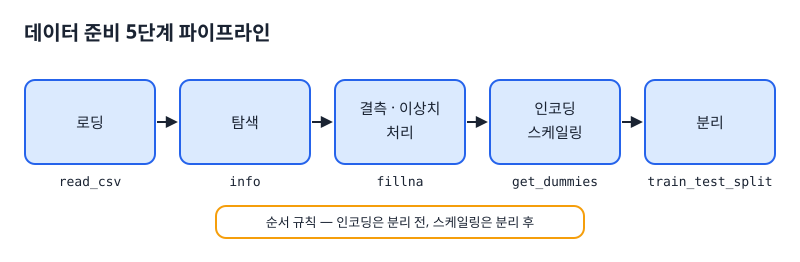
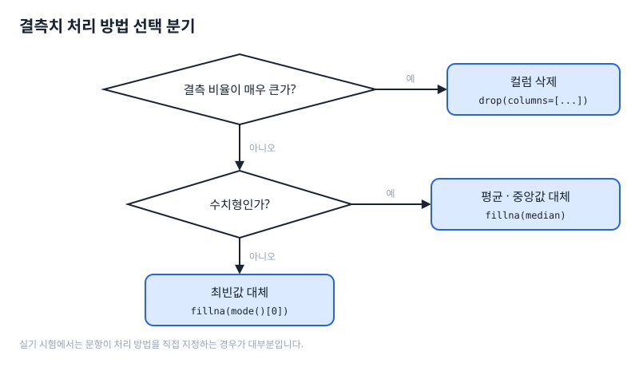
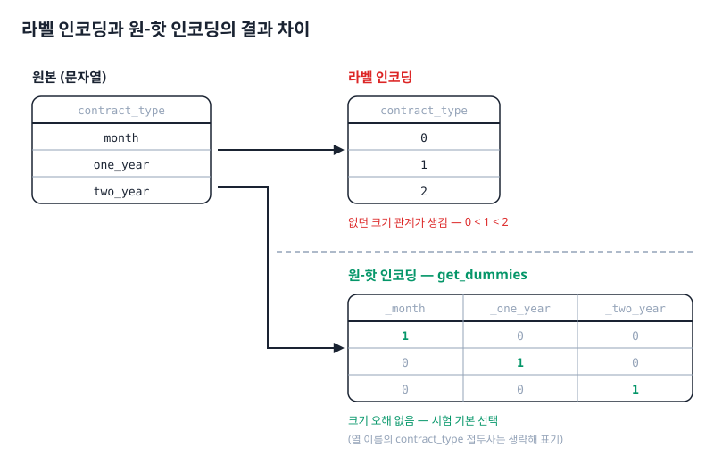
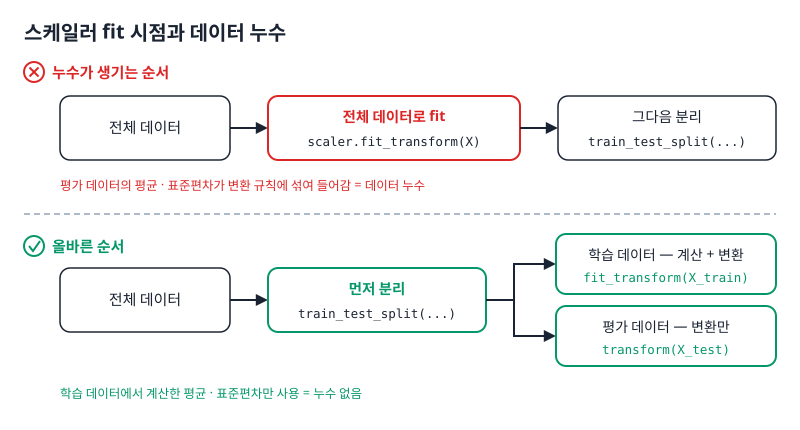
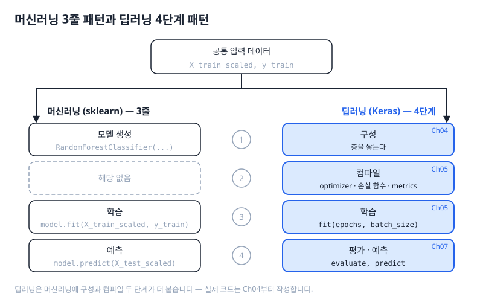

# 2회차 — 전제 지식 압축 정리: 데이터 준비와 머신러닝

- 범위: 2장 (https://newids.github.io/dl4aice/ch02.html)
- 발표 35분 안팎 + 질의응답 20분
- 사전 준비: 챕터 읽기 + 실습 셀 풀기 (https://newids.github.io/dl4aice/ch02.html#drills-ch02)

---

## 오늘의 목표

1. 결측치, 이상치, 인코딩, 스케일링을 문항 지시에 맞는 함수로 처리한다.
2. 인코딩은 분리 전에, 스케일링은 분리 후에 하는 순서를 이유와 함께 설명한다.
3. 머신러닝 3줄 패턴과 딥러닝 4단계의 차이, 그리고 딥러닝으로 넘어가기 전 점검 항목을 말한다.

---

## 진행 순서

| 구간 | 내용 | 시간 |
|---|---|---|
| 데이터 준비 흐름과 탐색 | 다섯 단계, 탐색과 시각화 | 4분 |
| 결측치, 이상치, 인코딩 | 함수 선택과 대입 규칙 | 7분 |
| 스케일링과 분리 | 데이터 누수와 순서 규칙 | 6분 |
| 머신러닝과 평가지표 | 3줄 패턴, 지표 고르기 | 3분 |
| 딥러닝으로 넘어가는 지점 | 인계 점검, 자주 틀리는 지점 | 6분 |
| 함께 풀기 | 실습 셀 두 문항 | 8분 |
| 정리 | 기억할 내용 정리 | 2분 |
| 질의응답 | 토론 질문과 질문 받기 | 20분 |

---

## 데이터 준비는 다섯 단계 (2분)



- 읽고, 보고, 고치고, 숫자로 바꾸고, 나눕니다. 단계마다 대표 함수가 정해져 있습니다.
- 문항은 이 순서로 출제되고, 앞 문항에서 만든 `df`를 뒤 문항이 이어받습니다.
- 변수를 덮어쓸지 새 이름을 줄지 미리 정해 둡니다.

---

## 먼저 데이터를 본다: 탐색과 시각화 (2분)

```python
print(df.info())                    # 자료형과 결측 여부
print(df.describe())                # 수치형 분포 요약
print(df.isnull().sum())            # 컬럼별 결측 개수
print(df['churn'].value_counts())   # 타깃 클래스 분포
```

- 시각화는 네 가지: `countplot`(범주 분포), `histplot`(수치 분포), `heatmap`(상관관계), `boxplot`(그룹별 분포 비교)
- 클래스 분포는 뒤에서 `stratify`와 평가지표를 정하는 근거입니다.
- `heatmap`은 문자열 컬럼이 섞이면 오류가 나므로 `df.select_dtypes(include='number').corr()`를 씁니다.

---

## 결측치: 지울 것인가 채울 것인가 (3분)



```python
df['monthly_fee'] = df['monthly_fee'].fillna(df['monthly_fee'].median())
df['contract_type'] = df['contract_type'].fillna(df['contract_type'].mode()[0])
```

- 문항이 방법을 지정하면 그대로 따릅니다. 이상치가 있거나 치우친 분포는 중앙값이 안전합니다.
- `fillna`는 새 Series를 반환하므로 반드시 다시 대입합니다. `mode()`는 Series를 반환하므로 `[0]`이 필요합니다.

---

## 이상치: IQR로 찾고 지시대로 처리 (2분)

```python
q1 = df['monthly_fee'].quantile(0.25)
q3 = df['monthly_fee'].quantile(0.75)
iqr = q3 - q1
lower, upper = q1 - 1.5 * iqr, q3 + 1.5 * iqr

outliers = df[(df['monthly_fee'] < lower) | (df['monthly_fee'] > upper)]
print('이상치 개수:', len(outliers))
df['monthly_fee'] = df['monthly_fee'].clip(lower, upper)
```

- `Q1 - 1.5*IQR` 미만, `Q3 + 1.5*IQR` 초과가 이상치입니다.
- "삭제하시오"인지 "경계값으로 대체하시오"인지 먼저 읽습니다. 삭제하면 바로 다음 줄에서 `reset_index(drop=True)`를 합니다.

---

## 인코딩: 문자열을 숫자로 (2분)



```python
df_enc = pd.get_dummies(df, columns=['contract_type'], dtype=int)
```

- 순서 없는 범주는 원-핫이 기본입니다. 라벨 인코딩은 없던 크기 관계를 만듭니다.
- `dtype=int`를 빼면 pandas 2.x 이상에서 True/False가 됩니다. `columns=[...]`를 빼면 문자 컬럼 전체가 변환됩니다.

---

## 스케일링: 특성의 크기를 맞춘다 (1분)

| 스케일러 | 변환 결과 | 언제 쓰나 |
|---|---|---|
| `StandardScaler` | 평균 0, 표준편차 1 | 지정이 없을 때의 기본 선택 |
| `MinMaxScaler` | 최소 0, 최대 1 | 0~1 범위로 맞추라는 지시가 있을 때 |

- 딥러닝에서는 스케일링이 사실상 필수입니다. 크기가 다르면 학습이 느려지거나 손실이 발산할 수 있습니다.
- 트리 계열 모델은 스케일링의 영향이 거의 없지만, 파이프라인을 하나로 통일해 두면 편합니다.

---

## 분리와 데이터 누수 (5분)



```python
X_train, X_test, y_train, y_test = train_test_split(
    X, y, test_size=0.3, random_state=42, stratify=y)
scaler = StandardScaler()
X_train_scaled = scaler.fit_transform(X_train)   # 계산 + 변환
X_test_scaled = scaler.transform(X_test)         # 변환만
```

- 인코딩은 분리 전, 스케일링은 분리 후입니다.

---

## 순서 규칙의 이유 (이어서)

- 인코딩을 분리 후에 따로 하면, 한쪽에만 있는 범주 때문에 컬럼 구성이 달라져 입력 shape이 어긋납니다.
- 스케일링을 분리 전에 하면, 평가 데이터의 평균과 표준편차가 변환 기준에 섞입니다. 이것이 데이터 누수입니다.
- 누수가 있어도 평가 점수는 오히려 좋아 보이므로 스스로 발견하기 어렵습니다.
- `test_size`는 평가 몫입니다. 8:2는 0.2, 7:3은 0.3입니다.
- `stratify=y`는 클래스 비율을 학습과 평가에 똑같이 유지합니다. 회귀에는 쓰지 않습니다.

---

## 머신러닝 3줄 패턴과 딥러닝 4단계 (2분)



- sklearn: 생성, `fit`, `predict`
- Keras: 구성(Ch04), 컴파일(Ch05), 학습(Ch05), 평가·예측(Ch07)
- 베이스라인은 최고 성능을 내려는 모델이 아니고 비교 기준으로 쓰는 모델입니다. 딥러닝 점수가 터무니없이 낮으면 전처리나 설정을 의심합니다.

---

## 평가지표의 종류와 함수 (1분)

| 문제 유형 | 대표 지표 | sklearn 함수 |
|---|---|---|
| 분류 | accuracy, precision, recall, f1 | `classification_report`, `accuracy_score` |
| 분류 (예측 분포) | 혼동 행렬 | `confusion_matrix` |
| 회귀 | mse, mae, r2 | `mean_squared_error`, `mean_absolute_error`, `r2_score` |

- 지표는 타깃 컬럼의 성질이 정합니다. 0/1이면 분류, 연속된 숫자면 회귀입니다.
- 불균형 데이터에서는 정확도만 보지 않고 클래스별 precision과 recall을 함께 봅니다.
- 자세한 계산과 해석은 7회차(Ch07)에서 다룹니다.

---

## 10번에서 11번으로: 데이터 인계 문제 (4분)

sklearn은 입력 형식을 덜 엄격하게 검사해서, 10번까지 통과한 데이터가 Keras에서는 오류를 낼 수 있습니다.

| 증상 | 원인 | 해결 |
|---|---|---|
| `inconsistent numbers of samples`, 이유 모를 `NaN` | 행 삭제 뒤 인덱스가 건너뜀 | 삭제 직후 `reset_index(drop=True)`, 같은 `df`에서 X, y 생성 |
| `Invalid dtype: object` | `bool`이 섞인 `to_numpy()`, 문자열 컬럼 인코딩 누락 | `get_dummies(..., dtype=int)`, `X.astype('float32')` |
| 정확도가 이상함, `(N, N)` | `(N, 1)`과 `(N,)` 방송 | `.ravel()`, 라벨 모양과 loss 이름 짝 맞추기 |

---

## 모델 구성 전 5줄 점검 셀 (이어서)

```python
print(X_train_scaled.shape, y_train.shape, X_train_scaled.dtype)
print(np.isnan(X_train_scaled).sum(), np.isnan(X_test_scaled).sum())
print(len(X_train_scaled) == len(y_train), len(X_test_scaled) == len(y_test))
print(X_train.index.equals(y_train.index), y_train.ndim)
print(y_train.nunique(), sorted(y_train.unique().tolist()))
```

- 5번의 클래스 수가 2이면 `Dense(1, 'sigmoid')`, 3 이상이면 `Dense(K, 'softmax')`, 연속값이면 `Dense(1)`입니다.
- 11번 첫 셀은 모델 구성이 아니라 이 점검 셀로 시작합니다.

---

## 자주 틀리는 지점 (2분)

- `df['col'].fillna(...)`의 결과를 다시 대입하지 않으면 결측이 그대로 남습니다.
- 전체 `X`에 `fit_transform`한 뒤 분리하면 누수입니다. 오류가 나지 않아 발견하기 어렵습니다.
- 올바른 코드에서도 평가 데이터의 스케일 결과가 0보다 작거나 1보다 클 수 있습니다. 오류가 아니므로 고치려다 누수를 만들지 않습니다.
- 결측 처리 없이 스케일링하면 `NaN`이 그대로 남아 딥러닝에서 `loss: nan`이 됩니다. 스케일링 직후 `np.isnan(...).sum()`이 0인지 봅니다.
- `stratify`에는 `y_train`이 아니라 분리 대상 전체 `y`를 넣습니다.

---

## 함께 풀기 1 — 데이터 준비 순서 (3분)

발표자는 사이트의 2장 실습 셀 `ch02-q1`을 띄우고 함께 풉니다.
https://newids.github.io/dl4aice/ch02.html#drills-ch02

문제: 인코딩 후 분리하고, 학습 데이터는 계산 + 변환, 평가 데이터는 변환만 하는 순서의 빈칸을 채웁니다. (데이터 생성 코드는 사이트에 있습니다.)

```python
df_enc = pd.___(df, columns=['contract_type'], dtype=int)
X = df_enc.drop(columns=['churn'])
y = df_enc['churn']
X_train, X_test, y_train, y_test = train_test_split(
    X, y, test_size=0.3, random_state=42, stratify=y)
scaler = StandardScaler()
X_train_scaled = scaler.___(X_train)
X_test_scaled = scaler.___(X_test)
```

---

## 함께 풀기 — 답과 이유

```python
df_enc = pd.get_dummies(df, columns=['contract_type'], dtype=int)
X_train_scaled = scaler.fit_transform(X_train)
X_test_scaled = scaler.transform(X_test)
```

- 인코딩은 분리 전에, 스케일러의 `fit`은 학습 데이터에서만 합니다.
- 평가 데이터에 `fit_transform`을 쓰면 평가 데이터의 통계가 변환 기준에 섞입니다.

---

## 함께 풀기 2 — 오류 2곳 고치기 (3분)

실습 셀 `ch02-q6`을 띄워 함께 풉니다. (https://newids.github.io/dl4aice/ch02.html#drills-ch02)

문제: 오류 없이 실행되지만, 결측이 그대로 남고 평가 데이터의 클래스 비율이 원본과 어긋납니다. 두 곳을 고칩니다. 소수 클래스는 10%입니다.

```python
___ = df['monthly_fee'].fillna(df['monthly_fee'].median())

X_train, X_test, y_train, y_test = train_test_split(
    X, y, test_size=0.3, random_state=42, ___=y)

print(df['monthly_fee'].isnull().sum())
print(y_test.value_counts(normalize=True).round(3).to_dict())
```

---

## 함께 풀기 — 답과 이유

```python
df['monthly_fee'] = df['monthly_fee'].fillna(df['monthly_fee'].median())

X_train, X_test, y_train, y_test = train_test_split(
    X, y, test_size=0.3, random_state=42, stratify=y)
```

- `fillna`는 원본을 바꾸지 않으므로 좌변에 `df['monthly_fee']`를 다시 대입해야 결측 개수가 0이 됩니다.
- 분류에서 클래스가 불균형하면 `stratify=y`가 없을 때 평가 데이터의 비율이 어긋날 수 있습니다.

---

## 정리 (2분)

- 순서: 읽기, 탐색, 결측·이상치, 인코딩, 분리, 스케일링, 모델링.
- 인코딩은 분리 전, 스케일링은 분리 후이며 `fit_transform`은 학습 데이터에만 씁니다.
- `fillna` 결과는 다시 대입하고, `get_dummies`에는 `columns`와 `dtype=int`를 씁니다.
- 분리 인자는 `test_size`, `random_state`, `stratify=y` 세 가지입니다.
- 딥러닝 전에는 shape, NaN, dtype, 인덱스, 클래스 수를 5줄로 점검합니다.

---

## 다음 회차 준비

- 3회차: 3장 "딥러닝은 어떻게 배우는가". Keras 없이 numpy만 사용합니다.
- 3장을 읽고 실습 셀 5문항(`#drills-ch03`)을 풀어 옵니다.
- 뉴런의 계산(가중합 + 편향 → 활성화)을 손으로 한 번 따라 써 옵니다.
- 오늘 막힌 문항이 있으면 질의응답 때 가져옵니다.

---

## 토론 질문

1. 결측이 매우 많은 컬럼을 버릴 것인가 채울 것인가? 교재는 "압도적으로 많으면 버린다"고만 하는데, 자기 기준은 어디입니까?
2. 지시가 없을 때 이상치를 삭제하겠습니까, 경계값으로 대체하겠습니까? 뒤 문항에 미치는 영향은 무엇입니까?
3. 10번과 11번 사이의 5줄 점검 셀을 90분 안에서 어디에 놓고 얼마나 할애하겠습니까?

---

## 예상 질문과 답 (1)

**Q1.** 평균과 중앙값 중 어느 것으로 채웁니까?
답: 실기에서는 대체로 문항이 통계량을 지정하므로 지시된 것을 씁니다. 지시가 없으면 분포가 치우쳤거나 이상치가 있을 때 평균이 이상치 쪽으로 치우치므로 중앙값이 안전합니다.

**Q2.** 라벨 인코딩과 원-핫 인코딩은 언제 구분해서 씁니까?
답: 순서가 있는 범주(저, 중, 고)는 라벨 인코딩이 자연스럽고, 순서가 없는 범주는 원-핫이 맞습니다. 시험에서는 `pd.get_dummies`가 가장 자주 요구됩니다.

**Q3.** 인코딩은 분리 전, 스케일링은 분리 후인 이유가 무엇입니까?
답: 분리 후 각각 인코딩하면 한쪽에만 있는 범주 때문에 컬럼 구성이 어긋납니다. 스케일링은 평균과 표준편차를 계산하는 `fit`이 평가 데이터를 보면 누수가 되므로 학습 데이터로만 합니다.

---

## 예상 질문과 답 (2)

**Q4.** 평가 데이터를 변환했더니 평균이 0이 아니고 값이 0~1을 벗어납니다. 잘못된 것입니까?
답: 정상입니다. 평가 데이터는 학습 데이터에서 구한 평균과 표준편차로 변환되므로 0 근처의 값으로 흩어지거나 `MinMaxScaler`에서 범위를 벗어날 수 있습니다. 오히려 평균이 정확히 0이면 누수를 의심합니다.

**Q5.** `stratify`는 항상 씁니까?
답: 분류 문제에서 클래스 비율을 유지하려는 지시가 있거나 클래스가 불균형할 때 씁니다. 연속형 타깃인 회귀에는 클래스가 없어 오류가 나므로 쓰지 않습니다.

**Q6.** 정확도만 보면 안 됩니까?
답: 이탈 고객이 10%라면 전부 "이탈 아님"으로 찍어도 정확도가 90%입니다. 그래서 `classification_report`로 클래스별 precision과 recall을 함께 봅니다.

**Q7.** 랜덤 포레스트는 스케일링이 필요 없다는데 왜 합니까?
답: 트리 계열은 값의 순서만 보므로 성능 영향이 거의 없습니다. 다만 같은 입력을 딥러닝 문항에도 이어서 쓰므로 파이프라인을 하나로 통일해 두면 다시 손댈 일이 없습니다.
