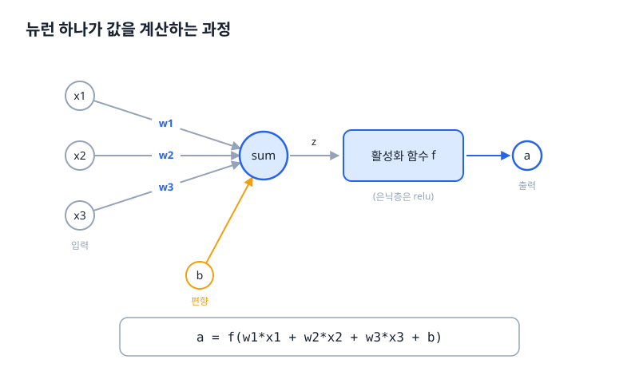
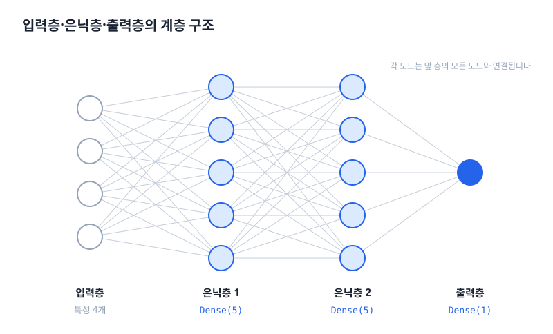
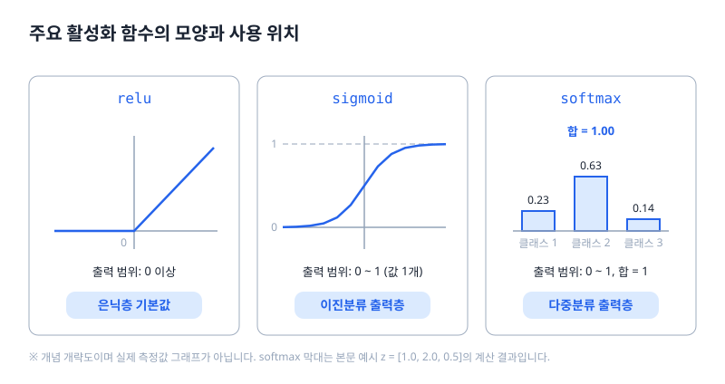
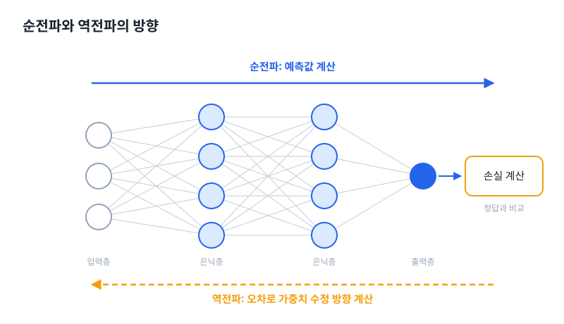
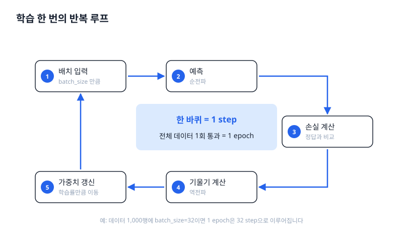

# 3회차 — 딥러닝은 어떻게 배우는가

- 범위: 3장 (https://newids.github.io/dl4aice/ch03.html)
- 발표 35분 안팎 + 질의응답 20분
- 사전 준비: 챕터 읽기 + 실습 셀 풀기 (https://newids.github.io/dl4aice/ch03.html#drills-ch03)

---

## 오늘의 목표

1. 뉴런 하나의 계산(가중합 + 편향, 그 뒤 활성화)을 numpy 두 줄로 쓴다.
2. relu, sigmoid, softmax의 출력 범위와 쓰는 자리를 구분한다.
3. 순전파, 역전파, step, epoch의 관계를 설명하고 가중치 갱신 횟수를 계산한다.

---

## 진행 순서

| 구간 | 내용 | 시간 |
|---|---|---|
| 뉴런과 층 | 뉴런, 층 구조와 shape, 파라미터 개수 | 9분 |
| 활성화 함수 | 쓰는 자리, 출력 범위, 필요한 이유 | 4분 |
| 학습의 원리 | 순전파와 역전파, step과 epoch | 6분 |
| 구조 설계와 점검 | 층과 노드 수, numpy 축소판, 자주 틀리는 지점 | 7분 |
| 함께 풀기 | 실습 셀 두 문항 | 8분 |
| 정리 | 기억할 내용 정리 | 2분 |
| 질의응답 | 토론 질문과 질문 받기 | 20분 |

---

## 뉴런 하나의 계산 (2분)



- 1단계: 입력마다 가중치를 곱해 더하고 편향을 더합니다. 결과가 `z`입니다.
- 2단계: `z`를 활성화 함수에 넣어 출력 `a`를 만듭니다.
- 학습으로 바뀌는 값은 가중치와 편향뿐이며, 이것이 모델의 파라미터입니다. 입력과 정답은 바뀌지 않습니다.

---

## 뉴런을 numpy로 계산해 보기 (2분)

```python
import numpy as np

x = np.array([2.0, 3.0, 1.0])     # 입력 3개
w = np.array([0.5, -1.0, 2.0])    # 가중치 3개
b = 0.1                           # 편향 1개

z = np.dot(w, x) + b              # 1단계: 가중합 + 편향
a = np.maximum(0, z)              # 2단계: 활성화(relu)
print(f"z = {z:.2f}, a = {a:.2f}")

w2 = np.array([0.5, -1.0, -2.0])
z2 = np.dot(w2, x) + b
print(f"z2 = {z2:.2f}, a2 = {np.maximum(0, z2):.2f}")
```

- 출력: `z = 0.10, a = 0.10` / `z2 = -3.90, a2 = 0.00`. `z`가 음수이면 relu가 0으로 자릅니다.

---

## 층 구조와 shape (3분)



| 층 | 노드 수를 정하는 기준 |
|---|---|
| 입력층 | 특성(컬럼) 개수로 고정 |
| 은닉층 | 설계자가 선택 (예: 64, 32) |
| 출력층 | 문제 유형이 결정 (Ch04) |

- 가중치 행렬의 모양은 (앞 층의 노드 수, 뒤 층의 노드 수)입니다. 편향은 뒤 층의 노드 수만큼 있습니다.

---

## 파라미터 개수 세기 (2분)

- 입력 3개 → 은닉 4개 층: 가중치 3 x 4 = 12, 편향 4, 합계 16개
- 입력 4개 → 은닉 5개 → 출력 1개 (실습 셀의 구조):
  - 첫 번째 층: 4 x 5 + 5 = 25
  - 두 번째 층: 5 x 1 + 1 = 6
  - 합계 31개
- 편향을 빼고 25로 답하는 것이 흔한 실수입니다.
- 4회차에서 `model.summary()`의 `Param #`이 이 계산과 같은 값을 보여 줍니다.

---

## 활성화 함수: 어디에 무엇을 쓰는가 (2분)

| 활성화 함수 | 출력 범위 | 쓰는 자리 |
|---|---|---|
| `relu` | 0 이상 | 은닉층 기본값 |
| `sigmoid` | 0 ~ 1 (값 1개) | 이진분류 출력층 |
| `softmax` | 0 ~ 1, 합이 1 (값 K개) | 다중분류 출력층 |
| 없음 | 제한 없음 | 회귀 출력층 |

- 은닉층은 relu가 표준입니다. sigmoid를 여러 층에 쓰면 신호가 점점 작아져 학습이 잘 되지 않습니다.
- 이진분류는 노드 1개 + `sigmoid`, 다중분류는 노드 K개 + `softmax`입니다.

---

## 활성화 함수의 모양과 필요한 이유 (2분)



- `z = [1.0, 2.0, 0.5]`일 때 sigmoid는 `[0.731 0.881 0.622]`로 각각 독립적이고, softmax는 `[0.231 0.629 0.14]`로 합이 1입니다.
- 은닉층에서 활성화 함수를 빼면 층을 아무리 쌓아도 하나의 직선식으로 합쳐집니다. 층 사이의 꺾인 함수가 직선을 구부립니다.

---

## 순전파와 역전파 (3분)



- 순전파: 입력에서 출력 방향으로 계산해 예측값을 만들고, 손실 함수로 오차를 숫자 하나로 잽니다.
- 역전파: 손실에서 거꾸로 가며 가중치 하나하나가 오차에 얼마나 기여했는지 계산합니다.
- 손실이 줄어드는 방향으로 가중치를 조금씩 옮기는 일은 optimizer가 하며, 보폭이 학습률입니다. 이 과정은 `model.fit()` 한 줄 안에서 일어납니다.
- 수식 유도는 시험 범위 밖입니다.

---

## 학습 루프: step과 epoch (3분)



- 1 step: 배치 한 묶음을 넣어 예측, 채점, 수정 방향 계산, 가중치 갱신을 한 바퀴 돈 것
- 1 epoch: 학습 데이터 전체를 한 번 다 사용한 것
- 1,000행, `batch_size=32`: 1,000 / 32 = 31.25이고 남는 행도 한 묶음이므로 32 step입니다.
- `epochs=50`이면 50 x 32 = 1,600번 갱신됩니다.

---

## 층과 노드를 몇 개 둘 것인가 (2분)

- 너무 작으면 학습 데이터에서도 성능이 낮습니다(과소적합).
- 너무 크면 학습 데이터를 외워 평가 데이터 성능이 떨어집니다(과적합). 6회차에서 다룹니다.
- 시험은 최적 구조를 찾는 실험을 요구하지 않고 "은닉층 2개 이상" 같은 지시를 줍니다.

| 항목 | 시험장 기본값 |
|---|---|
| 은닉층 수 | 2~3개 (지시가 있으면 지시 우선) |
| 노드 수 | 64 → 32 처럼 점점 줄이기 |
| 은닉층 활성화 | 전부 `relu` |

---

## numpy 축소판: 순전파, 손실, 가중치 흔들기 (3분)

```python
rng = np.random.default_rng(42)
X = rng.normal(size=(6, 4))
y = np.array([0, 1, 1, 0, 1, 0])
W1 = rng.normal(size=(4, 5)) * 0.5
b1 = np.zeros(5)
W2 = rng.normal(size=(5, 1)) * 0.5
b2 = np.zeros(1)

def forward(X, W1, b1, W2, b2):
    h = relu(X @ W1 + b1)
    out = sigmoid(h @ W2 + b2)
    return out.ravel()

pred = forward(X, W1, b1, W2, b2)
loss = binary_crossentropy(y, pred)
```

- `relu`, `sigmoid`, `binary_crossentropy`는 교재 3장 코드의 정의를 씁니다.
- `W2[0, 0]`에 0.1을 더하면 손실이 0.708에서 0.7099로 늘었습니다. 이 가중치는 줄이는 쪽으로 옮겨야 합니다.

---

## 자주 틀리는 지점 (2분)

- 이진분류 출력층에 `Dense(1, activation='softmax')`를 쓰면 값이 하나뿐이라 항상 1.0이 나옵니다. 오류 없이 학습만 되지 않습니다.
- 은닉층에 sigmoid를 쓰면 실행은 되지만 학습이 더뎌집니다. 은닉층은 relu입니다.
- 가중치 갱신 단위는 샘플이 아니라 배치입니다. 2,000행, `batch_size=50`, `epochs=10`이면 400회이며 20,000회가 아닙니다.
- 자투리 배치도 1 step이므로 나눗셈 결과는 올림합니다.
- 가중치 행렬을 `(1, 5)`처럼 뒤집으면 `h @ W2`에서 shape 오류가 납니다. relu에 파이썬 `max`를 쓰면 배열에서 오류가 나므로 `np.maximum`을 씁니다.

---

## 함께 풀기 1 — 활성화 함수 세 가지를 numpy로 구현 (4분)

발표자는 사이트의 3장 실습 셀 `ch03-q1`을 띄우고 함께 풉니다.
https://newids.github.io/dl4aice/ch03.html#drills-ch03

문제: `relu`, `sigmoid`, `softmax`를 numpy로 구현해 `relu_out`, `sig_out`, `soft_out`에 담고 출력 범위를 확인합니다.

```python
z = np.array([-2.0, 0.5, 3.0])

relu_out = np.___(0, z)
sig_out = 1 / (1 + np.___(-z))
soft_out = np.exp(z) / np.exp(z).___()
```

---

## 함께 풀기 — 답과 이유

```python
relu_out = np.maximum(0, z)
sig_out = 1 / (1 + np.exp(-z))
soft_out = np.exp(z) / np.exp(z).sum()
```

- relu의 최솟값은 0입니다. 배열에는 `np.maximum`을 씁니다.
- sigmoid는 원소마다 독립이므로 합이 1이 아닙니다.
- softmax는 합이 1입니다. 값 하나로는 늘 1.0이 되므로 이진분류 출력에 쓰지 않습니다.

---

## 함께 풀기 2 — 2층 신경망의 순전파와 파라미터 개수 (4분)

실습 셀 `ch03-q5`를 띄워 함께 풉니다. (https://newids.github.io/dl4aice/ch03.html#drills-ch03)

문제: 특성 4개, 샘플 6개를 받아 은닉 5노드, 이진분류 확률 1개를 내는 순전파입니다. `W2`의 shape, 활성화 두 곳, 파라미터 총 개수에 쓸 행렬을 채웁니다.

```python
W2 = rng.normal(size=___)
b2 = np.zeros(1)

h = ___(X @ W1 + b1)
out = ___(h @ W2 + b2)

n_params = W1.size + b1.size + ___.size + b2.size
```

---

## 함께 풀기 — 답과 이유

```python
W2 = rng.normal(size=(5, 1))
h = relu(X @ W1 + b1)
out = sigmoid(h @ W2 + b2)
n_params = W1.size + b1.size + W2.size + b2.size
```

- `W2`는 (앞 층 노드 수, 뒤 층 노드 수) = (5, 1)입니다.
- 은닉층은 relu, 이진분류 출력층은 sigmoid입니다.
- 파라미터는 20 + 5 + 5 + 1 = 31개입니다. 편향 `b2`까지 세어야 합니다.

---

## 정리 (2분)

- 뉴런은 `z = 가중합 + 편향`, `a = 활성화(z)`이고 학습으로 바뀌는 값은 가중치와 편향뿐입니다.
- 입력층은 특성 수, 출력층은 문제 유형이 정하고, 은닉층만 설계자가 고릅니다.
- 은닉층 relu, 이진 출력 sigmoid(1개), 다중 출력 softmax(K개), 회귀 출력은 활성화 없음.
- 순전파로 예측하고 역전파로 수정 방향을 구해 가중치를 갱신하는 한 바퀴가 1 step이며, 데이터 전체를 한 번 도는 것이 1 epoch입니다.
- 시험장 기본 구조는 은닉층 2~3개, relu, 64 → 32입니다.

---

## 다음 회차 준비

- 4회차: 4장 "Keras로 모델 만들기". 3장의 개념을 `Sequential`과 `Dense` 코드로 옮깁니다.
- 4장을 읽고 실습 셀(`#drills-ch04`)을 풀어 옵니다.
- 오늘 센 파라미터 개수(31개)를 `model.summary()`의 `Param #`과 비교해 볼 준비를 합니다.
- 활성화 함수 표(relu, sigmoid, softmax, 없음)를 보지 않고 쓸 수 있는지 확인해 옵니다.

---

## 토론 질문

1. 지시가 "은닉층 2개 이상"뿐일 때 층과 노드 수를 어떻게 정하겠습니까? 기본값(64 → 32)을 그대로 쓰는 것이 적절합니까?
2. 오류 없이 학습만 되지 않는 실수(노드 1개 + softmax, 은닉층 sigmoid)를 시험장에서 어떻게 빨리 발견하겠습니까?
3. `model.summary()`의 `Param #`을 시험 중에 손계산으로 검산할 가치가 있습니까?

---

## 예상 질문과 답 (1)

**Q1.** 편향은 왜 필요합니까?
답: 가중치가 "이 입력을 얼마나 중요하게 볼 것인가"라면 편향은 "기본적으로 얼마만큼 얹고 시작할 것인가"를 나타내는 값입니다. 노드마다 하나씩 있고 가중치와 함께 학습으로 바뀝니다. `Param #`에도 포함되므로 세지 않으면 개수가 틀립니다.

**Q2.** 은닉층에 활성화 함수를 쓰지 않으면 어떻게 됩니까?
답: 곱하고 더하는 연산만 반복하므로 층을 아무리 쌓아도 하나의 선형식으로 합쳐집니다. 층 사이에 relu 같은 꺾인 함수가 있어야 복잡한 패턴을 배울 수 있습니다.

**Q3.** sigmoid와 softmax는 둘 다 확률인데 아무거나 써도 됩니까?
답: 아닙니다. sigmoid는 값 1개를 0~1로 만드는 이진분류용이고, softmax는 K개 값을 합이 1인 분포로 만드는 다중분류용입니다. 이 차이가 출력층 노드 수를 결정합니다.

---

## 예상 질문과 답 (2)

**Q4.** 노드 1개에 softmax를 쓰면 왜 학습이 안 됩니까?
답: 값이 하나뿐이라 입력이 무엇이든 출력이 1.0이 됩니다. 출력이 입력에 반응하지 않아 수정 방향도 사라지고, 오류 메시지 없이 정확도가 제자리에 머뭅니다.

**Q5.** step과 epoch는 어떻게 다릅니까?
답: step은 배치 한 묶음으로 가중치를 한 번 갱신하는 단위이고, epoch는 학습 데이터 전체를 한 번 도는 단위입니다. 2,000행, `batch_size=50`이면 1 epoch가 40 step이고 `epochs=10`이면 총 400번 갱신됩니다.

**Q6.** 역전파 수식을 외워야 합니까?
답: 아닙니다. 수식 유도는 시험 범위 밖입니다. "손실이 줄어드는 방향으로 가중치가 자동으로 수정되고 그것이 `model.fit()` 안에서 일어난다"는 방향 감각이면 충분합니다.

**Q7.** 은닉층 노드를 몇 개로 해야 합니까?
답: 시험은 최적 구조를 찾는 실험을 요구하지 않습니다. 지시가 있으면 지시를 따르고, 없으면 은닉층 2~3개, 64 → 32처럼 줄여 가는 relu 구조를 기본으로 씁니다.

**Q8.** 회귀 모델의 출력층에는 활성화 함수를 씁니까?
답: 쓰지 않습니다. 예측한 숫자 그 자체가 출력이어야 하므로 출력 범위를 제한하지 않습니다. 이 내용은 4회차와 5회차에서 코드로 확인합니다.
