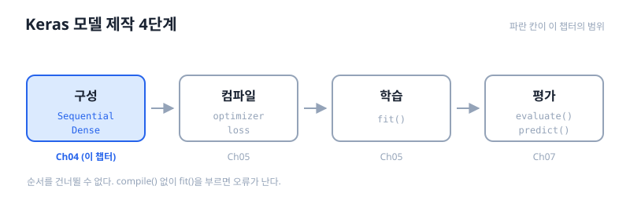
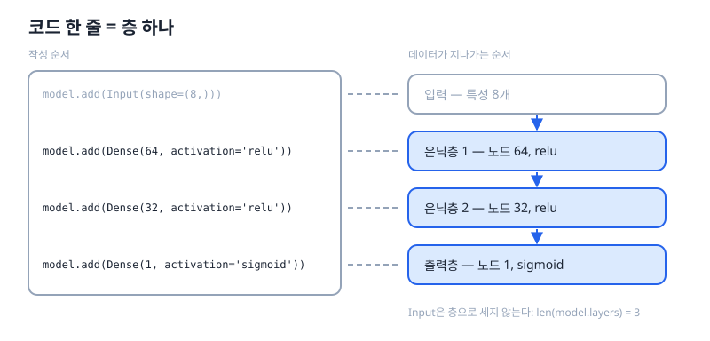
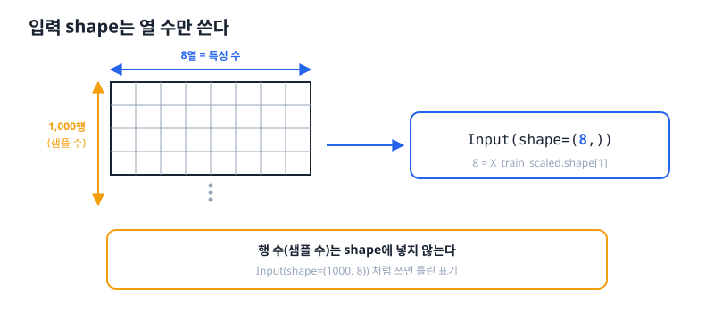
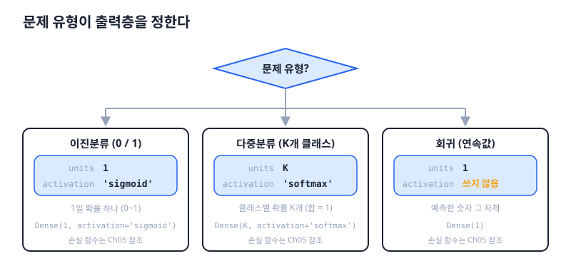
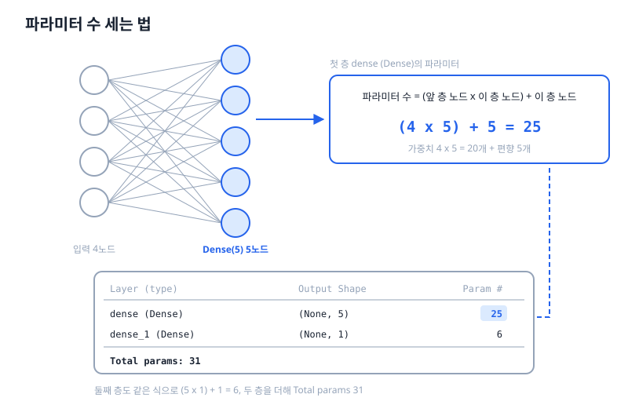
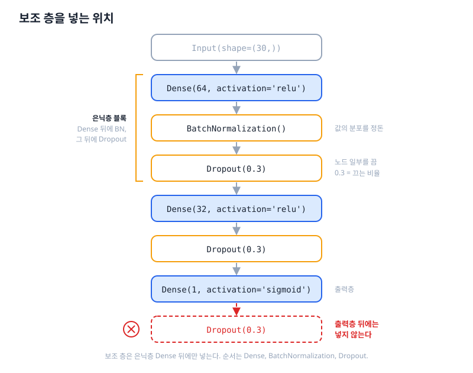

# 4회차 — Keras로 모델 만들기

- 범위: 교재 4장 (https://newids.github.io/dl4aice/ch04.html)
- 발표 35분 안팎 + 질의응답 20분
- 사전 준비: 챕터 읽기 + 실습 셀 풀기

---

## 오늘의 목표

1. `Sequential`과 `Dense`로 은닉층 2개 이상의 모델을 직접 작성한다.
2. 입력 shape와 출력층(units, activation)을 문제 유형에 맞게 정한다.
3. `summary()`의 Output Shape와 Param #를 읽고, Dropout과 BatchNormalization의 위치를 맞게 놓는다.

---

## 진행 순서

| 구간 | 내용 | 시간 |
|---|---|---|
| 도입 | 모델 제작 4단계와 4장의 범위 (4.1) | 2분 |
| 입력 | Sequential 구성과 입력 shape (4.2~4.3) | 6분 |
| 출력 | 문제 유형별 출력층 (4.4) | 3분 |
| 비교 | Sequential과 Functional 비교 | 4분 |
| 확인 | summary()와 파라미터 수 (4.5) | 4분 |
| 보조 층 | Dropout과 BatchNormalization (4.6) | 3분 |
| 점검 | 자주 틀리는 지점과 표준 코드 | 3분 |
| 실습 | 함께 풀기 두 문항 | 8분 |
| 질의응답 | 토론 질문과 질문 받기 | 20분 |

---

## 4.1 모델 제작 4단계와 시험에서의 위치 (2분)



- 순서는 구성, 컴파일, 학습, 평가입니다. 4장은 첫 단계인 구성만 다룹니다.
- 구성에서 정하는 것은 입력 개수, 은닉층 구조, 출력층(개수와 활성화 함수) 세 가지입니다.
- 시험은 14문항, 90분, 합격 80점이며, 11~13번이 딥러닝 모델링, 14번이 평가와 새 입력 예측입니다. 회차마다 다를 수 있으므로 KT AICE 공식 공지를 확인합니다.

---

## 4.2 Sequential 모델 구성 (3분)



```python
model = Sequential()
model.add(Input(shape=(n_features,)))        # 입력 정의
model.add(Dense(64, activation='relu'))      # 은닉층 1
model.add(Dense(32, activation='relu'))      # 은닉층 2
model.add(Dense(1, activation='sigmoid'))    # 출력층
```

- `model.add()`를 호출한 순서가 데이터가 지나가는 순서입니다.
- `len(model.layers)`는 3입니다. `Input`은 층으로 세지 않습니다.
- 은닉층은 입력층과 출력층을 뺀 중간층입니다. 기본값은 은닉층 2개, 64에서 32로 줄어드는 형태입니다.

---

## 4.3 입력 shape (2분)



- `Input(shape=(n,))`의 n은 특성(컬럼) 수입니다. 1000행 8열이면 `shape=(8,)`입니다.
- 샘플 수는 넣지 않습니다. summary에서 `None`으로 보이는 자리입니다.
- `(30)`은 정수이고 `(30,)`이 원소 하나짜리 튜플입니다. 쉼표를 빠뜨리지 않습니다.

---

## 4.3 특성 수는 데이터에서 뽑는다 (1분)

```python
print(X_train_scaled.shape)          # (398, 30)
n_features = X_train_scaled.shape[1] # 30
```

- 숫자를 손으로 적으면 원-핫 인코딩이나 컬럼 삭제 뒤에 틀립니다.
- 구버전 표기 `Dense(64, activation='relu', input_shape=(n_features,))`는 읽을 줄만 알면 됩니다.
- 새로 쓸 때는 Keras 2와 3 양쪽에서 동작하는 `Input(shape=(n,))`를 씁니다.

---

## 4.4 문제 유형별 출력층 (2분)



| 문제 유형 | 출력층 코드 |
|---|---|
| 이진분류 | `Dense(1, activation='sigmoid')` |
| 다중분류 (K개) | `Dense(K, activation='softmax')` |
| 회귀 | `Dense(1)` (활성화 없음) |

---

## 4.4 클래스 수와 회귀 출력 (1분)

```python
n_class = len(np.unique(y_multi))          # 3
multi_model.add(Dense(n_class, activation='softmax'))

reg_model.add(Dense(1))                    # 회귀는 activation 없음
```

- 클래스 수 K도 `len(np.unique(y))`로 뽑습니다. 3클래스에 `Dense(2, 'softmax')`를 쓰면 학습 단계에서 오류가 납니다.
- 회귀에 sigmoid를 붙이면 출력이 0~1 범위로 제한되어 집값 같은 큰 값을 맞힐 수 없습니다.
- 손실 함수와의 짝짓기는 5회차(5장)에서 다룹니다.

---

## 4.4 Sequential과 Functional 비교 (4분)

같은 이진분류 모델입니다. 바뀌는 줄은 모델을 조립하는 부분뿐입니다.

```python
# Sequential
model = Sequential()
model.add(Input(shape=(n_features,)))
model.add(Dense(64, activation='relu'))
model.add(Dense(32, activation='relu'))
model.add(Dense(1, activation='sigmoid'))

# Functional
inputs = Input(shape=(n_features,))
x = Dense(64, activation='relu')(inputs)
x = Dense(32, activation='relu')(x)
outputs = Dense(1, activation='sigmoid')(x)
model = Model(inputs=inputs, outputs=outputs)
```

- 함수형은 층을 함수처럼 호출해 앞 층의 출력에 연결하고, 마지막에 `Model(inputs=..., outputs=...)`로 묶습니다.
- 출력층의 units와 activation을 고르는 규칙은 두 방식이 같습니다.
- 챕터 4.4의 "직접 바꿔 보기" 위젯(문제 유형 × API 비교)에서 탭을 바꿔 가며 바뀌는 줄을 확인합니다. 발표자는 이 위젯을 화면에 띄웁니다.

---

## 4.5 summary()로 확인한다 (2분)



- 구성 직후 반드시 `model.summary()`를 한 번 호출합니다.
- Output Shape의 `None`은 샘플 수가 정해지지 않았다는 뜻이며 오류가 아닙니다.
- Total params가 0이거나 "build되지 않았다"는 메시지가 나오면 `Input`을 빠뜨린 것입니다.

---

## 4.5 파라미터 수 계산 (2분)

파라미터 수 = (앞 층 노드 수 x 이 층 노드 수) + 이 층 노드 수

```
입력 4 → 은닉 5 → 출력 1
dense   : (4 x 5) + 5 = 25
dense_1 : (5 x 1) + 1 = 6
Total params: 31
```

- 뒤의 항이 노드마다 하나씩 있는 편향입니다.
- 편향을 빼고 세면 정확히 편향 개수만큼 모자랍니다. 출력층도 합계에 넣습니다.
- 발표자는 `30 → 64` 층이 `(30 x 64) + 64 = 1984`가 되는지 청중과 함께 계산해 봅니다.

---

## 4.6 Dropout과 BatchNormalization을 놓는 위치 (2분)



- `Dropout(0.3)`의 0.3은 끄는 비율입니다. 시험에서는 0.2~0.5, 지시가 없으면 0.3 정도를 씁니다.
- 순서는 `Dense`, `BatchNormalization`, `Dropout`입니다.
- 출력층 뒤에는 넣지 않습니다. 마지막 층은 항상 `Dense`입니다.

---

## 4.6 보조 층을 넣은 표준 배치 (1분)

```python
model.add(Input(shape=(30,)))
model.add(Dense(64, activation='relu'))
model.add(BatchNormalization())
model.add(Dropout(0.3))
model.add(Dense(32, activation='relu'))
model.add(Dropout(0.3))
model.add(Dense(1, activation='sigmoid'))
```

- `Dropout`의 Param #는 0입니다. 정상입니다.
- `BatchNormalization`은 노드 수의 4배(64 x 4 = 256)로 표시되고 절반(128)이 Non-trainable입니다. 오류가 아닙니다.

---

## 자주 틀리는 지점 (2분)

- `Input(shape=(1000, 8))`처럼 샘플 수를 넣는다. 구성 단계에서 오류가 없고 `fit()`에서 shape 불일치 오류가 납니다.
- `shape=(8)`로 쓰고 쉼표를 빠뜨린다.
- 은닉층 2개 조건에서 `Dense(64)`와 출력층만 쓴다. 은닉층이 1개뿐입니다.
- 클래스 수를 눈으로 세어 출력층 units를 잘못 적는다.
- 회귀 출력층에 sigmoid를 붙이거나, 출력층 뒤에 Dropout을 넣는다.
- `compile()`을 빠뜨리고 `fit()`을 부른다.

---

## 시험장 표준 코드 (1분)

```python
n_features = X_train_scaled.shape[1]

model = Sequential()
model.add(Input(shape=(n_features,)))
model.add(Dense(64, activation='relu'))
model.add(BatchNormalization())
model.add(Dropout(0.3))
model.add(Dense(32, activation='relu'))
model.add(Dropout(0.3))
model.add(Dense(1, activation='sigmoid'))   # 유형별 교체 지점
model.summary()
```

- 유형이 바뀌면 마지막 `Dense` 한 줄만 4.4의 표대로 바꿉니다.
- 이 모델은 아직 학습할 수 없습니다. 다음 회차에서 `compile()`과 `fit()`을 붙입니다.

---

## 함께 풀기 (1) 이진분류 모델 구성 (4분)

발표자는 교재 사이트의 실습 셀을 열고 함께 풉니다: https://newids.github.io/dl4aice/ch04.html#drills-ch04 (문항 ch04-q3)

`X_tr`의 shape가 `(800, 15)`인 이진분류입니다. 은닉층 2개(64, 32, relu)로 `model`을 구성합니다.

```python
n_features = ___

model = Sequential()
model.add(___)
model.add(Dense(64, activation='relu'))
model.add(Dense(32, activation='relu'))
model.add(___)

model.summary()
```

- 먼저 청중이 빈칸 세 곳을 말하게 하고, 실습 셀에 입력해 실행합니다.

---

## 함께 풀기 — 답과 이유

문항 1 (ch04-q3)의 답입니다.

```python
n_features = X_tr.shape[1]
model.add(Input(shape=(n_features,)))
model.add(Dense(1, activation='sigmoid'))
```

- 이진분류 출력은 1일 확률 하나이므로 노드 1개와 sigmoid가 한 쌍입니다.
- Total params는 (15x64+64) + (64x32+32) + (32x1+1) = 1,024 + 2,080 + 33 = 3,137입니다.
- 흔한 오류: `shape[0]`(800)을 쓴다. 출력층에 relu를 그대로 둔다.

---

## 함께 풀기 (2) 오류 2곳 고치기 (4분)

발표자는 실습 셀을 열고 함께 풉니다: https://newids.github.io/dl4aice/ch04.html#drills-ch04 (문항 ch04-q6)

y_train에는 클래스 0~3이 있습니다. 원래 코드는 출력 노드가 2개였고 Dropout이 출력층 뒤에 있었습니다.

```python
n_class = ___

model.add(Dense(32, activation='relu'))
model.add(___(0.3))
model.add(Dense(___, activation='softmax'))

print('출력 shape:', model.output_shape)
print('마지막 층 :', type(model.layers[-1]).__name__)
```

- 어떤 줄이 두 오류를 각각 고치는지 청중이 먼저 말해 봅니다.

---

## 함께 풀기 — 답과 이유

문항 2 (ch04-q6)의 답입니다.

```python
n_class = len(np.unique(y_train))
model.add(Dropout(0.3))
model.add(Dense(n_class, activation='softmax'))
```

- 출력층 노드 수는 클래스 개수와 같아야 하므로 데이터에서 뽑습니다.
- Dropout은 은닉층 Dense 뒤에만 둡니다. 출력층 뒤에 두면 최종 확률이 무작위로 0이 됩니다.
- 구성 직후 summary의 마지막 행이 `Dense`이고 Output Shape가 `(None, 4)`인지 확인하면 두 오류를 한 번에 잡습니다.

---

## 정리

- 구성, 컴파일, 학습, 평가 중 4장은 구성입니다. 시험 답안에는 `compile()`까지 반드시 씁니다.
- `Input(shape=(X_train_scaled.shape[1],))`: 샘플 수는 넣지 않고 쉼표를 붙입니다.
- 출력층: 이진 `Dense(1,'sigmoid')`, 다중 `Dense(K,'softmax')`, 회귀 `Dense(1)`.
- Param # = (앞 층 노드 수 x 이 층 노드 수) + 이 층 노드 수.
- 보조 층은 `Dense` 뒤에 `BatchNormalization`, `Dropout` 순서이고 출력층 뒤에는 넣지 않습니다.

---

## 다음 회차 준비

- 다음 회차는 5회차, 5장 "컴파일과 학습"입니다.
- 챕터 5의 1~2절(compile 세 인자, 손실 함수 선택 표)을 읽어 옵니다.
- 5장 실습 셀 6문항 중 손실 함수 짝짓기(ch05-q1)를 먼저 풀어 봅니다.
- 이번 회차 표준 코드를 보지 않고 써 보고, `summary()`의 Total params가 직접 계산한 값과 맞는지 확인합니다.

---

## 토론 질문

1. 시험에서 은닉층 수와 노드 수를 어떻게 정하겠습니까? 64에서 32 기본값을 그대로 쓰는 경우와 바꾸는 경우를 나누어 말해 봅시다.
2. 문제가 구성 방식을 지정하지 않으면 Sequential과 Functional 중 무엇을 쓰겠습니까? 그 이유는 무엇입니까?
3. 구성을 마친 직후 `summary()`에서 어떤 순서로 무엇을 점검하겠습니까? 시간이 부족할 때 꼭 남기는 점검 한 가지는 무엇입니까?

---

## 예상 질문과 답 (1)

**Q1.** `Input`은 층인데 왜 `len(model.layers)`에 안 잡힙니까?
답: `Input`은 연산을 하는 층이 아니라 입력 형태를 선언하는 것입니다. 그래서 `Dense` 세 개만 층으로 세어 3이 나옵니다.

**Q2.** 은닉층 노드 수를 64와 32로 정한 근거가 있습니까?
답: 정해진 정답은 없습니다. 앞 층이 크고 뒤 층이 작아지는 64에서 32를 실기의 기본값으로 삼으라는 것이 교재의 권고이며, 층과 노드를 크게 늘리면 과적합 위험도 함께 커집니다.

**Q3.** `input_shape=`를 쓰면 틀린 답이 됩니까?
답: 챕터 실행 확인에서는 Keras 3에서 경고가 나온 뒤 정상 동작했습니다. 다만 Keras 3에서 권장되지 않는 표기이므로 `Input(shape=(n,))`를 표준으로 씁니다.

---

## 예상 질문과 답 (2)

**Q4.** summary에서 BatchNormalization 파라미터가 왜 4배이고 Non-trainable이 생깁니까?
답: 학습으로 조정하는 값 두 종류와, 학습 중 관찰한 통계를 저장해 두는 값 두 종류가 함께 있기 때문입니다. 64노드면 256개이고 그중 128개가 Non-trainable이며 오류가 아닙니다.

**Q5.** 회귀 출력층에 relu를 붙이면 안 됩니까?
답: 교재는 회귀 출력층에 활성화 함수를 쓰지 않는다고 규정합니다. 값을 제한하는 활성화는 큰 값이나 음수 값을 맞히지 못하게 만들기 때문입니다.

**Q6.** 다중분류에서 클래스 수가 틀리면 언제 오류가 납니까?
답: 구성 단계에서는 조용하고 학습 단계에서 라벨과 출력 개수가 맞지 않아 오류가 납니다. 그래서 `len(np.unique(y))`로 뽑고 구성 직후 summary로 Output Shape를 확인합니다.

**Q7.** 시험에서 Functional API를 꼭 알아야 합니까?
답: 챕터는 Sequential을 표준으로 다루고 함수형은 비교 수준으로만 소개합니다. 지시문이 어느 쪽을 요구하든 출력층 규칙은 같으므로, 두 형태에서 바뀌는 줄을 읽을 수 있으면 충분합니다.
