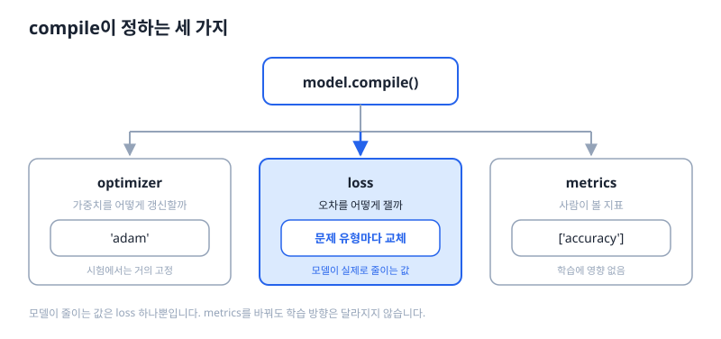
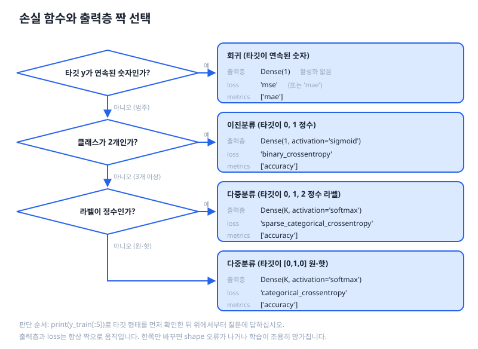
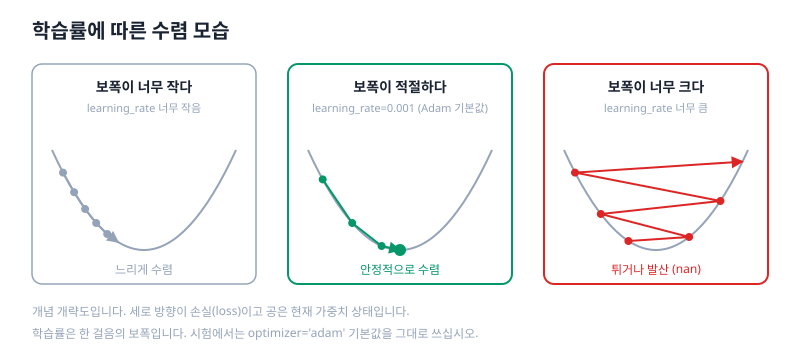
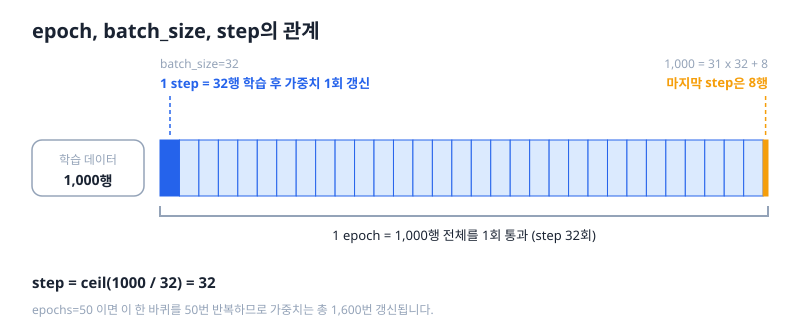
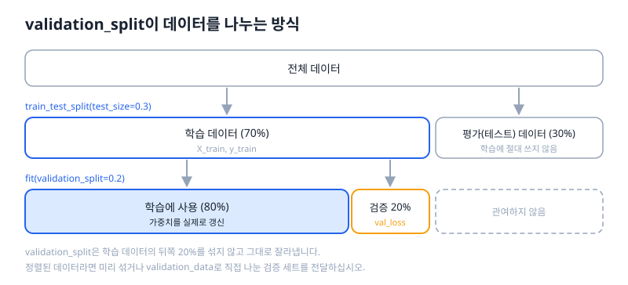
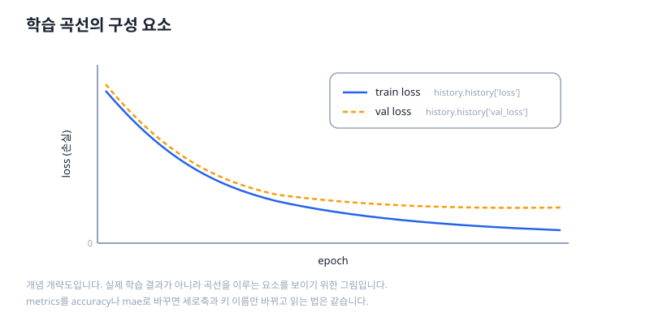

# 5회차 — 컴파일과 학습

- 범위: 교재 5장 (https://newids.github.io/dl4aice/ch05.html)
- 발표 35분 안팎 + 질의응답 20분
- 사전 준비: 챕터 읽기 + 실습 셀 풀기

---

## 오늘의 목표

1. 문제 유형과 라벨 형태(정수, 원-핫)에 맞는 출력층과 손실 함수를 한 쌍으로 고른다.
2. `fit`의 epochs, batch_size, validation_split을 쓰고 1 epoch의 step 수를 계산한다.
3. `history`의 키를 읽고 학습 곡선을 그린다.

---

## 진행 순서

| 구간 | 내용 | 시간 |
|---|---|---|
| compile | compile이 정하는 세 가지 (5.1) | 3분 |
| 손실 함수 | 문제 유형별 손실 함수 선택 (5.2) | 10분 |
| optimizer | optimizer와 학습률 (5.3) | 2분 |
| fit | epochs, batch_size, step (5.4) | 5분 |
| 검증과 기록 | 검증 데이터와 history (5.5~5.6) | 5분 |
| 점검 | 자주 틀리는 지점과 표준 코드 | 3분 |
| 실습 | 함께 풀기 두 문항 | 8분 |
| 질의응답 | 토론 질문과 질문 받기 | 20분 |

---

## 5.1 compile이 정하는 세 가지 (2분)



```python
model.compile(optimizer='adam',
              loss='binary_crossentropy',
              metrics=['accuracy'])
```

- `loss`는 줄일 대상, `optimizer`는 줄이는 방법, `metrics`는 사람이 볼 지표입니다.
- 시험에서 바뀌는 것은 `loss`입니다. optimizer는 거의 `'adam'`입니다.

---

## 5.1 loss와 metrics는 자리가 다릅니다 (1분)

- `metrics`에 무엇을 넣어도 학습 방향은 바뀌지 않습니다. 모델이 줄이는 것은 `loss`뿐입니다.
- `loss='accuracy'`는 `compile()`은 통과하지만 `fit()`에서 `ValueError`가 납니다.
- 손실 함수를 `metrics` 자리에 넣는 것도 의미가 없거나 shape 오류가 납니다.
- 분류는 `metrics=['accuracy']`, 회귀는 `metrics=['mae']`로 고정해 둡니다.

---

## 5.2 손실 함수는 타깃의 형태가 정합니다 (3분)



- 질문은 순서대로 세 개입니다. 숫자인가 범주인가, 클래스가 2개인가, 라벨이 정수인가 원-핫인가.
- 출력층과 손실 함수는 반드시 한 짝으로 바꿉니다. 한쪽만 바꾸면 조용히 망가지거나 오류가 납니다.
- 4장에서 미뤄 둔 짝짓기가 여기서 확정됩니다.

---

## 5.2 손실 함수 선택 표 (3분)

| 문제 유형 | 타깃(y) | 출력층 | loss | metrics |
|---|---|---|---|---|
| 이진분류 | 0, 1 정수 | `Dense(1,'sigmoid')` | `binary_crossentropy` | `accuracy` |
| 다중분류 | 정수 라벨 | `Dense(K,'softmax')` | `sparse_categorical_crossentropy` | `accuracy` |
| 다중분류 | 원-핫 | `Dense(K,'softmax')` | `categorical_crossentropy` | `accuracy` |
| 회귀 | 연속값 | `Dense(1)` 활성화 없음 | `mse` (또는 `mae`) | `mae` |

- 판단 순서는 `print(y_train[:5])`로 타깃 형태를 먼저 확인하는 것입니다.

---

## 5.2 compile 코드와 sparse의 의미 (2분)

```python
# 다중분류 — y가 0,1,2 정수일 때
model.add(Dense(3, activation='softmax'))
model.compile(optimizer='adam', loss='sparse_categorical_crossentropy', metrics=['accuracy'])

# 회귀
model.add(Dense(1))
model.compile(optimizer='adam', loss='mse', metrics=['mae'])
```

- `sparse_`는 라벨이 정수 하나로 압축되어 있다는 뜻입니다. `[0, 2, 1, 2]` 형태입니다.
- 원-핫 `[[1,0,0],[0,0,1],...]`이면 `categorical_crossentropy`를 씁니다.
- 정수 라벨에 `categorical_crossentropy`를 쓰면 `fit()`에서 shape 오류가 납니다.
- 챕터의 "직접 바꿔 보기" 위젯에서 문제 유형 탭을 바꿔 loss와 metrics가 달라지는 것을 확인합니다.

---

## 5.2 회귀의 손실 함수와 출력층 (2분)

- 지시가 없으면 `loss='mse'`, `metrics=['mae']`가 무난합니다.
- mse는 오차를 제곱하므로 큰 오차에 크게 반응하고, mae는 이상치의 영향을 덜 받습니다.
- 회귀 출력층은 `Dense(1)`이고 활성화를 쓰지 않습니다. sigmoid를 붙이면 출력이 0~1에 갇힙니다.
- 분류 코드를 복사해 회귀로 고칠 때는 출력층, loss, metrics 세 곳을 한 묶음으로 고칩니다.
- sigmoid가 남은 문제는 오류 메시지를 내지 않고 mae가 큰 값에서 멈춥니다.

---

## 5.3 optimizer와 학습률 (2분)



- 학습률은 한 걸음의 보폭입니다. 작으면 느리고 크면 바닥을 지나쳐 튕깁니다.
- 지시가 없으면 문자열 `'adam'`을 그대로 씁니다. Adam의 기본 학습률은 0.001입니다.
- 손실이 `nan`으로 튀면 학습률을 0.0001 수준으로 낮춥니다. 시험 시간에는 튜닝보다 기본값이 낫습니다.

---

## 5.4 epoch, batch_size, step (3분)



```python
history = model.fit(X_train_scaled, y_train,
                    epochs=50, batch_size=32,
                    validation_split=0.2, verbose=1)
```

- `batch_size`는 한 번에 몇 행을 보고 가중치를 고칠지, `epochs`는 전체 데이터를 몇 번 반복할지입니다.
- 표준값은 epochs 50~100, batch_size 32입니다. `batch_size`를 생략하면 기본값 32입니다.

---

## 5.4 step 수 계산 (2분)

```
step 수 = ceil( 학습에 실제로 쓰이는 행 수 / batch_size )

validation_split 없음 : ceil(1000 / 32) = 32 step
validation_split=0.2  : 1000 x 0.8 = 800행 → ceil(800 / 32) = 25 step
```

- `validation_split`이 먼저 빠지므로 step 수는 검증분을 뺀 행 수로 셉니다.
- 진행 막대가 예상한 `32/32`가 아니라 `25/25`로 찍히면 이 계산을 빠뜨린 것입니다.
- epochs를 무작정 늘리는 것은 과적합 대책이 아닙니다. 6회차의 EarlyStopping으로 이어집니다.

---

## 5.5 검증 데이터를 떼어내는 두 방법 (3분)



```python
# 방법 A — 비율만 지정 (시험 기본형)
history = model.fit(X_train_scaled, y_train, epochs=50, batch_size=32, validation_split=0.2)

# 방법 B — 검증 데이터를 직접 만들어 전달
history = model.fit(X_tr, y_tr, epochs=50, batch_size=32, validation_data=(X_val, y_val))
```

- 두 방법은 함께 쓰지 않습니다. 분리 방식(stratify 등)을 지시하면 방법 B를 씁니다.
- `validation_split`은 섞지 않고 배열의 마지막 20%를 잘라냅니다. 정렬된 데이터는 미리 섞습니다.

---

## 5.6 history 읽기 (2분)



```python
print(history.history.keys())
# dict_keys(['accuracy', 'loss', 'val_accuracy', 'val_loss'])
print('가장 낮은 val_loss:', min(history.history['val_loss']))
print('총 학습 epoch 수:', len(history.history['loss']))
```

- `val_` 접두어가 붙은 키는 검증 데이터에서 잰 값입니다. 키 순서는 보장되지 않으니 이름으로 찾습니다.
- 회귀에서 `metrics=['mae']`이면 키는 `mae`, `val_mae`입니다.

---

## 자주 틀리는 지점 (2분)

- `y_train`이 정수 라벨인데 `categorical_crossentropy`를 쓴다. 오류는 `fit()`에서야 납니다.
- 회귀 출력층에 sigmoid를 남기고 loss만 `mse`로 바꾼다.
- `loss`와 `metrics` 자리를 바꿔 넣는다.
- `n_class = 3`처럼 클래스 수를 손으로 적는다.
- step 수를 검증분을 빼지 않고 `ceil(2000 / 50) = 40`으로 답한다.
- 검증 데이터를 지정하지 않아 `val_loss`가 history에 없다.

---

## 시험장 표준 코드 (1분)

```python
model.compile(optimizer='adam',
              loss='binary_crossentropy',       # 교체 지점 (2) 손실 함수
              metrics=['accuracy'])             # 교체 지점 (3) 지표

history = model.fit(X_train_scaled, y_train,
                    epochs=50, batch_size=32,
                    validation_split=0.2,
                    verbose=1)

print(history.history.keys())
```

- 출력층(교체 지점 1), loss, metrics 세 줄만 유형에 맞게 바꿉니다.
- 학습이 끝나면 학습 곡선을 그려 확인하는 습관을 만듭니다.

---

## 함께 풀기 (1) 네 유형의 손실 함수 짝짓기 (4분)

발표자는 실습 셀을 열고 함께 풉니다: https://newids.github.io/dl4aice/ch05.html#drills-ch05 (문항 ch05-q1)

`y_bin` (0/1), `y_int` (0/1/2 정수), `y_oh` (원-핫 200x3), `y_reg` (연속값)입니다. 표현이 아니라 y의 실제 shape와 값으로 판단합니다.

```python
model_a.compile(optimizer='adam', loss=___, metrics=['accuracy'])   # y_bin
model_b.compile(optimizer='adam', loss=___, metrics=['accuracy'])   # y_int
model_c.compile(optimizer='adam', loss=___, metrics=['accuracy'])   # y_oh
model_d = Sequential([Input(shape=(6,)), Dense(16, activation='relu'), ___])
model_d.compile(optimizer='adam', loss=___, metrics=['mae'])        # y_reg
```

---

## 함께 풀기 — 답과 이유

문항 1 (ch05-q1)의 답입니다.

```python
loss='binary_crossentropy'                 # (가)
loss='sparse_categorical_crossentropy'     # (나)
loss='categorical_crossentropy'            # (다)
Dense(1)  /  loss='mse'                    # (라)
```

- (나)와 (다)는 출력층이 `Dense(3, 'softmax')`로 같고 라벨 shape만 다릅니다.
- 맞바꾸면 오류는 `fit()`에서 납니다. `print(y.shape)` 한 줄로 예방합니다.
- 회귀 출력층에 sigmoid를 붙이면 오류 없이 학습되지만 50~250 값을 맞힐 수 없습니다.

---

## 함께 풀기 (2) 다중분류 컴파일·학습과 step 수 (4분)

발표자는 실습 셀을 열고 함께 풉니다: https://newids.github.io/dl4aice/ch05.html#drills-ch05 (문항 ch05-q4)

`X_train` shape `(2000, 12)`, `y_train`은 0/1/2 정수 라벨입니다. 검증 20%, epochs=60, batch_size=50입니다.

```python
n_class = ___

model.add(Dense(64, activation='relu'))
model.add(Dense(32, activation='relu'))
model.add(___)

model.compile(optimizer='adam', loss=___, metrics=['accuracy'])

history = model.fit(X_train, y_train, epochs=60, batch_size=50,
                    ___, verbose=0)
print('1 epoch 당 step 수:', math.ceil(len(X_train) * 0.8 / 50))
```

---

## 함께 풀기 — 답과 이유

문항 2 (ch05-q4)의 답입니다.

```python
n_class = len(np.unique(y_train))
model.add(Dense(n_class, activation='softmax'))
loss='sparse_categorical_crossentropy'
validation_split=0.2
```

- step 수는 `validation_split`이 먼저 적용되어 `ceil(1600 / 50) = 32`입니다. `ceil(2000 / 50) = 40`은 오답입니다.
- 라벨이 1부터 시작하면 클래스 수는 맞아도 sparse 손실이 범위 오류를 냅니다. 먼저 0부터 맞춥니다.
- 원-핫으로 바꿀 때는 loss 한 줄만 `categorical_crossentropy`로 고칩니다. 출력층은 그대로입니다.

---

## 정리

- `compile`: loss는 줄일 대상, optimizer는 `'adam'`, metrics는 학습에 영향 없는 지표입니다.
- 이진 `sigmoid` + `binary_crossentropy`, 다중 `softmax` + (정수 라벨 `sparse_categorical_crossentropy` / 원-핫 `categorical_crossentropy`), 회귀 활성화 없음 + `mse`.
- 판단은 `print(y_train[:5])`로 타깃 형태를 먼저 확인하는 것에서 시작합니다.
- `fit` 표준은 epochs 50~100, batch_size 32, validation_split 0.2이고, step 수는 검증분을 뺀 행 수로 셉니다.
- `history.history`는 딕셔너리이며 `loss`, `val_loss`를 한 그래프에 함께 그립니다.

---

## 다음 회차 준비

- 다음 회차는 6회차, 6장 "과적합 진단과 대응"입니다.
- 챕터 6의 학습 곡선 판독(6.2)과 EarlyStopping, ModelCheckpoint 절(6.4~6.5)을 읽어 옵니다.
- 6장 실습 셀 5문항 중 콜백 표준 3줄(ch06-q3)을 먼저 풀어 봅니다.
- 5장 표준 코드로 학습한 뒤 `plot_history`로 곡선을 그려 두 선이 어떻게 움직이는지 메모해 옵니다.

---

## 토론 질문

1. 문제 지문이 "예측"이라고만 적혀 있을 때 회귀인지 분류인지, 라벨이 정수인지 원-핫인지 어떤 순서로 확인하겠습니까?
2. 회귀에서 `mse`와 `mae` 중 무엇을 loss로 쓰겠습니까? 지시가 없을 때의 선택 이유를 말해 봅시다.
3. 시험 시간이 부족할 때 epochs, batch_size, learning_rate 중 무엇을 건드리고 무엇을 기본값으로 두겠습니까?

---

## 예상 질문과 답 (1)

**Q1.** `metrics=['accuracy']`를 빼면 학습이 달라집니까?
답: 학습 방향은 달라지지 않습니다. 모델은 `loss`만 줄이고 `metrics`는 화면과 history에 같이 찍히는 지표입니다. 다만 정확도 기록과 `val_accuracy` 키가 사라집니다.

**Q2.** 이진분류인데 `sparse_categorical_crossentropy`를 쓰면 안 됩니까?
답: 챕터의 표준은 이진분류에 `binary_crossentropy`와 `Dense(1, 'sigmoid')` 한 쌍입니다. 시험에서는 표의 짝을 그대로 쓰는 것이 안전합니다.

**Q3.** `validation_split`과 `train_test_split`의 차이는 무엇입니까?
답: `train_test_split`은 학습용과 평가(테스트)용을 나누고, `validation_split`은 학습 데이터 안에서 매 epoch 성적을 재는 검증분을 떼어 냅니다. 테스트 데이터는 마지막에 한 번만 씁니다.

---

## 예상 질문과 답 (2)

**Q4.** 정수 라벨을 원-핫으로 바꿔서 쓰고 싶으면 어떻게 합니까?
답: `tf.keras.utils.to_categorical(y_train)`로 바꾸고 loss를 `categorical_crossentropy`로 맞춥니다. 라벨과 loss는 한 쌍으로 바꿔야 하며 출력층은 그대로입니다.

**Q5.** `epochs=500`으로 올리면 성능이 더 좋아지지 않습니까?
답: 어느 지점부터는 학습 데이터에만 맞추는 과적합이 시작되어 평가 성능이 오히려 떨어집니다. epochs를 넉넉히 주고 EarlyStopping으로 멈추게 하는 방법을 6장에서 배웁니다.

**Q6.** history 키는 항상 `accuracy`입니까?
답: metrics에 넣은 이름 그대로입니다. 회귀에서 `metrics=['mae']`이면 `mae`와 `val_mae`가 됩니다. 순서가 보장되지 않으므로 `sorted(history.history.keys())`로 확인합니다.

**Q7.** `validation_split`을 주면 정렬된 데이터에서 무슨 일이 생깁니까?
답: 배열의 마지막 20%를 그대로 잘라 쓰므로 한 클래스만 검증 데이터에 몰려 `val_accuracy`가 이상한 값으로 고정될 수 있습니다. `train_test_split`을 거쳐 섞였는지 확인하고, 의심되면 `print(y_train[:20])`을 찍어 봅니다.
