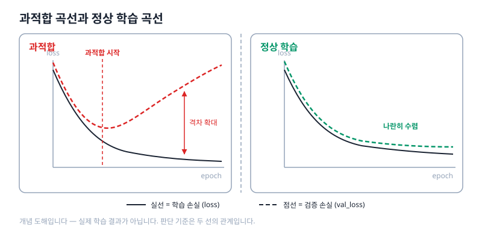
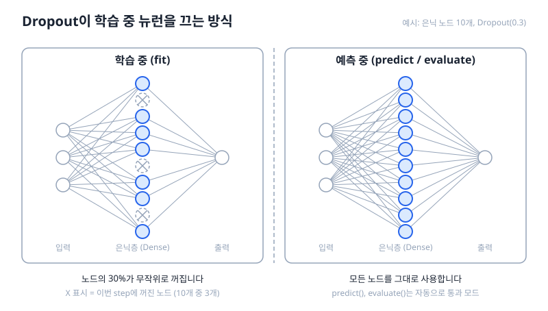
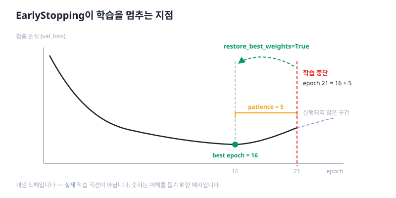
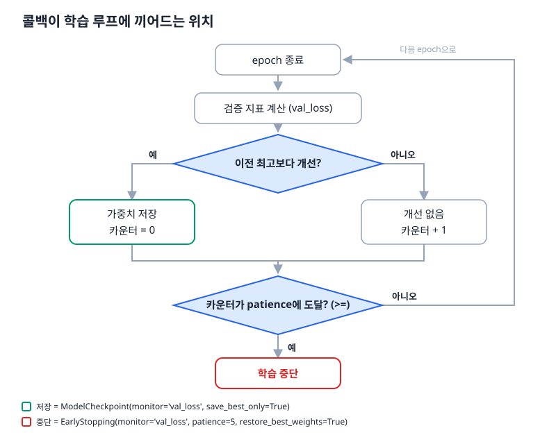
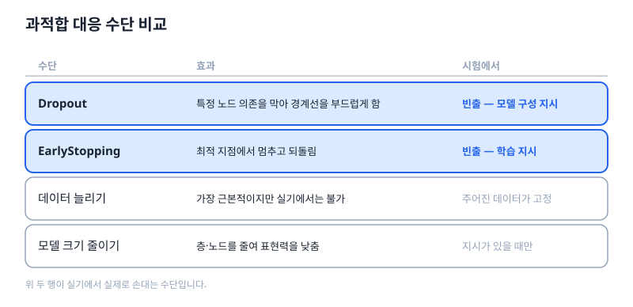

# 6회차 — 과적합 진단과 대응

- 범위: 교재 6장 (https://newids.github.io/dl4aice/ch06.html)
- 발표 35분 안팎 + 질의응답 20분
- 사전 준비: 챕터 읽기 + 실습 셀 풀기

---

## 오늘의 목표

1. 학습 곡선(`loss`, `val_loss`)을 보고 과적합, 과소적합, 정상 학습을 판별하고 조치를 고른다.
2. `EarlyStopping`과 `ModelCheckpoint`를 표준 인자로 쓰고 `fit()`의 `callbacks`에 넘긴다.
3. 중단 epoch = 최적 epoch + patience 관계로 콜백이 동작했는지 스스로 검산한다.

---

## 진행 순서

| 구간 | 내용 | 시간 |
|---|---|---|
| 곡선 읽기 | 과적합과 학습 곡선 읽기 (6.1~6.2) | 8분 |
| Dropout | 학습할 때만 끄는 층 (6.3) | 4분 |
| EarlyStopping | 인자와 중단 지점 계산 (6.4) | 6분 |
| ModelCheckpoint | 저장과 복원 (6.5) | 4분 |
| 대응 순서 | 과적합 대응 수단을 고르는 순서 (6.6) | 2분 |
| 점검 | 자주 틀리는 지점과 표준 코드 | 3분 |
| 실습 | 함께 풀기 두 문항 | 8분 |
| 질의응답 | 토론 질문과 질문 받기 | 20분 |

---

## 6.1 과적합이란 무엇인가 (2분)

- 과적합은 모델이 학습 데이터에서는 성능이 높고 처음 보는 데이터에서는 성능이 떨어지는 상태입니다.
- 과소적합은 모델이 너무 단순해서 학습 데이터에서도 새 데이터에서도 성능이 낮은 상태입니다.
- 적정 상태는 학습 데이터와 새 데이터 모두에서 성능이 높은 상태입니다.
- 학습 중에는 결정 경계 그림을 볼 수 없고 숫자만 보입니다. 그래서 학습 곡선이 필요합니다.
- 3장에서 본 대로 층과 노드를 늘리면 표현력과 함께 과적합 위험도 커집니다.

---

## 6.2 학습 곡선에서 두 선이 벌어지는 지점 (2분)



- 판별 기준은 한 문장입니다. 학습 손실은 계속 내려가는데 검증 손실이 어느 지점부터 올라가면 과적합입니다.
- 두 곡선을 한 그래프에 함께 그려야 비교가 됩니다.
- 과적합 판단의 기준은 `val_loss`입니다. 학습 정확도가 1.0이라는 사실만으로 잘 학습됐다고 답하지 않습니다.

---

## 6.2 곡선 모양별 진단과 조치 (2분)

| 곡선 모양 | 진단 | 조치 |
|---|---|---|
| 두 선이 함께 내려가 나란히 수렴 | 정상 | 그대로 두거나 epoch을 조금 더 |
| 학습 손실 하강, 검증 손실 상승 | 과적합 | Dropout, EarlyStopping 적용 |
| 두 선 모두 높은 값에서 정체 | 과소적합 | 층·노드 늘리기, epoch 늘리기, Dropout 줄이기 |
| 검증 손실이 위아래로 심하게 튐 | 학습 불안정 | batch_size 늘리기, 학습률 낮추기 |

- 과소적합에 과적합 대응을 쓰면 성능이 더 나빠집니다. 진단이 먼저입니다.

---

## 6.2 과적합을 일부러 만든 실험 결과 (2분)

400행, 은닉층 256노드 2개, 50 epoch으로 학습한 결과입니다.

```
마지막 epoch 학습 손실: 0.0005
마지막 epoch 검증 손실: 1.4136
검증 손실 최저 epoch: 3 / 최저값: 0.5857
마지막 학습 정확도: 1.0 / 마지막 검증 정확도: 0.7321
```

- 학습 데이터는 한 문제도 틀리지 않지만 검증 손실은 최저값의 두 배가 넘게 올랐습니다.
- 쓸 만한 모델은 3번째 epoch에 있었고 나머지 47번은 학습 데이터에만 맞추는 데 쓰였습니다.
- 난수를 고정하는 `tf.keras.utils.set_random_seed(42)` 한 줄이 없으면 숫자가 매번 달라집니다.

---

## 6.3 Dropout은 학습할 때만 끈다 (2분)



- `Dropout(0.3)`은 학습 중 매 step마다 노드의 30%를 무작위로 임시로 끕니다. 영구 삭제가 아닙니다.
- 특정 노드 하나에 의존하지 못하게 해서 여러 노드가 고르게 쓰이도록 합니다.
- `predict()`와 `evaluate()`에서는 아무 노드도 끄지 않습니다. 같은 입력의 예측값은 항상 같습니다.

---

## 6.3 Dropout 비율을 바꿔 본 결과 (2분)

| Dropout 비율 | 최저 val_loss | 마지막 val_loss | 최고 val_acc |
|---|---|---|---|
| 0.0 | 0.5857 | 1.4784 | 0.7321 |
| 0.3 | 0.5776 | 1.6485 | 0.7857 |
| 0.5 | 0.5722 | 1.2115 | 0.7857 |
| 0.8 | 0.5633 | 0.5864 | 0.7143 |

- 0.3의 마지막 검증 손실이 Dropout이 없는 경우보다 나쁩니다. 비율을 올릴수록 좋아지는 것은 아닙니다.
- 0.8은 마지막 val_loss가 최저값에서 크게 벗어나지 않지만 최고 val_acc가 가장 낮습니다. 노드 대부분이 꺼져 학습 기회를 잃었습니다.
- 실기에서는 0.2~0.5, 지시가 없으면 0.3을 씁니다. 네 조건 모두 최저값은 초반에 찍혔고, 그래서 EarlyStopping이 함께 필요합니다.

---

## 6.4 EarlyStopping의 세 인자 (3분)



| 인자 | 의미 | 시험 표준값 |
|---|---|---|
| `monitor` | 무엇을 기준으로 판단할지 | `'val_loss'` |
| `patience` | 개선이 없는 epoch을 몇 번까지 기다릴지 | `5` (또는 지시값) |
| `restore_best_weights` | 멈춘 뒤 가장 좋았던 가중치로 되돌릴지 | `True` |

- `restore_best_weights`의 기본값은 `False`입니다. 빠뜨리면 patience만큼 더 나빠진 마지막 가중치가 남습니다.

---

## 6.4 EarlyStopping 적용과 검산 (3분)

```python
es = EarlyStopping(monitor='val_loss', patience=5, restore_best_weights=True)
history = model.fit(X_train_scaled, y_train, epochs=100, batch_size=32,
                    validation_split=0.2, callbacks=[es], verbose=0)
print('실제로 학습한 epoch 수:', len(history.history['loss']))
print('검증 손실 최저 epoch:', int(np.argmin(history.history['val_loss'])) + 1)
```

```
실제로 학습한 epoch 수: 11
검증 손실 최저 epoch: 6
```

- 중단 epoch = 최적 epoch + patience입니다. 11 = 6 + 5입니다.
- 두 숫자의 차이가 patience와 다르거나 지시한 epochs를 다 썼다면 콜백이 동작하지 않은 것입니다.
- 콜백을 쓸 때 epochs는 100~200으로 넉넉히 줍니다.

---

## 6.5 ModelCheckpoint와 콜백 흐름 (2분)



| 인자 | 의미 | 시험 표준값 |
|---|---|---|
| 첫 번째 위치 인자 | 저장할 파일 경로 | `'best_model.keras'` |
| `monitor` | 개선 판단 기준 | `'val_loss'` |
| `save_best_only` | 개선된 경우에만 덮어쓸지 | `True` |

- `save_best_only=True`가 없으면 마지막 epoch 모델이 남습니다.

---

## 6.5 두 콜백을 함께 적용하고 복원한다 (2분)

```python
es = EarlyStopping(monitor='val_loss', patience=5, restore_best_weights=True)
mc = ModelCheckpoint('best_model.keras', monitor='val_loss', save_best_only=True)

history = bc_model.fit(Xb_train_scaled, yb_train, epochs=100, batch_size=32,
                       validation_split=0.2, callbacks=[es, mc], verbose=0)

best_model = load_model('best_model.keras')
loss, acc = best_model.evaluate(Xb_test_scaled, yb_test, verbose=0)
```

- 챕터 실행 결과는 40 epoch에서 멈췄고 최저 epoch이 35였습니다. 35 + 5 = 40입니다.
- 콜백은 만들기만 해서는 동작하지 않습니다. `callbacks=[es, mc]`로 `fit()`에 넘겨야 합니다.
- 파일명은 `.keras`를 씁니다. 문제가 "가장 성능이 좋은 모델을 저장하시오"라고 하면 `ModelCheckpoint`가 정답입니다.

---

## 6.6 과적합 대응 수단을 고르는 순서 (2분)



- 순서는 곡선을 그려 과적합인지 확인, Dropout이 없으면 추가, EarlyStopping에 멈추는 지점을 맡기는 것입니다.
- 그래도 검증 손실이 높으면 은닉층 노드 수를 절반으로 줄여 봅니다. 데이터 늘리기는 실기에서 할 수 없습니다.
- 두 곡선이 모두 높은 곳에서 정체하면 과소적합이므로 대응이 반대입니다.

---

## 자주 틀리는 지점 (2분)

- 콜백 객체를 만들고 `fit()`의 `callbacks`에 넘기지 않는다. 오류가 없어 가장 잡기 어렵습니다.
- `restore_best_weights=True`를 빠뜨린다.
- `monitor='loss'` 또는 `'accuracy'`처럼 `val_` 접두어를 빠뜨려 학습 데이터를 감시한다.
- `validation_split` 없이 `monitor='val_loss'`를 쓴다. 경고만 뜨고 콜백이 동작하지 않습니다.
- 과적합인데 노드 수를 늘린다. `argmin`의 결과에 `+ 1`을 빠뜨려 epoch 번호가 한 칸 어긋난다.
- `val_accuracy`를 감시하면서 `mode='max'`를 쓰지 않는다. 클수록 좋은 지표에는 `mode='max'`를 함께 적습니다.

---

## 시험장 표준 코드 (1분)

```python
es = EarlyStopping(monitor='val_loss', patience=5, restore_best_weights=True)
mc = ModelCheckpoint('best_model.keras', monitor='val_loss', save_best_only=True)

history = model.fit(X_train_scaled, y_train,
                    epochs=100, batch_size=32,
                    validation_split=0.2,
                    callbacks=[es, mc],
                    verbose=1)

print('실제로 학습한 epoch 수:', len(history.history['loss']))
print('검증 손실 최저 epoch:', int(np.argmin(history.history['val_loss'])) + 1)
```

- 이어서 `loss`와 `val_loss`를 한 그래프에 그리고, 평가는 7회차에서 다룹니다.

---

## 함께 풀기 (1) 학습 곡선 읽고 과적합 대응하기 (4분)

발표자는 실습 셀을 열고 함께 풉니다: https://newids.github.io/dl4aice/ch06.html#drills-ch06 (문항 ch06-q1)

`h0`는 은닉층 256노드 2개를 대책 없이 학습한 기록입니다. 일부만 옮긴 골격입니다.

```python
best_epoch = ___

model.add(Dense(256, activation='relu'))
model.add(___)
model.add(Dense(256, activation='relu'))

es = EarlyStopping(monitor=___, patience=5, restore_best_weights=True)
history = model.fit(X_train_scaled, y_train, epochs=100, batch_size=16,
                    validation_split=0.2, callbacks=___, verbose=0)
```

- `best_epoch`는 val_loss가 가장 낮은 epoch 번호이며 1부터 셉니다.

---

## 함께 풀기 — 답과 이유

문항 1 (ch06-q1)의 답입니다.

```python
best_epoch = int(np.argmin(h0.history['val_loss'])) + 1
model.add(Dropout(0.3))
es = EarlyStopping(monitor='val_loss', patience=5, restore_best_weights=True)
callbacks=[es]
```

- `argmin`은 0부터 센 위치를 돌려주므로 `+ 1`로 epoch 번호를 만듭니다.
- 조치는 곡선으로 과적합 확인, Dropout 추가, EarlyStopping으로 멈출 지점을 맡기는 순서입니다.
- `monitor='loss'`는 한 단어 차이로 감시 대상이 학습 데이터가 되어 과적합을 잡지 못합니다.

---

## 함께 풀기 (2) 콜백 표준 3줄 (4분)

발표자는 실습 셀을 열고 함께 풉니다: https://newids.github.io/dl4aice/ch06.html#drills-ch06 (문항 ch06-q3)

지시는 다음과 같습니다. 검증 손실 기준으로 5 epoch 개선이 없으면 중단하고 최적 가중치로 되돌립니다. 검증 손실이 개선될 때만 `'best_model.keras'`로 저장합니다. 두 콜백을 모두 학습에 적용합니다.

```python
es = ___
mc = ___

history = model.fit(X_train_scaled, y_train,
                    epochs=100, batch_size=32,
                    validation_split=0.2,
                    ___,
                    verbose=0)
```

---

## 함께 풀기 — 답과 이유

문항 2 (ch06-q3)의 답입니다.

```python
es = EarlyStopping(monitor='val_loss', patience=5, restore_best_weights=True)
mc = ModelCheckpoint('best_model.keras', monitor='val_loss', save_best_only=True)
callbacks=[es, mc]
```

- `restore_best_weights`의 기본값이 `False`이므로 직접 적어야 합니다.
- 두 콜백은 `fit(..., callbacks=[es, mc])`로 넘겨야만 동작합니다.
- `epochs=100`이어도 최저 epoch + 5에서 멈추므로 실제 epoch 수는 100보다 작습니다.
- 표준 파일명은 `.keras`입니다. `.h5`나 확장자 없는 이름은 피합니다.

---

## 정리

- 과적합은 학습 손실 하강과 검증 손실 상승으로 판단하고, 근거는 언제나 `val_loss`입니다.
- 두 손실이 모두 높은 곳에서 정체하면 과소적합이며 대응은 노드·epoch 늘리기로 반대입니다.
- `EarlyStopping(monitor='val_loss', patience=5, restore_best_weights=True)`
- `ModelCheckpoint('best_model.keras', monitor='val_loss', save_best_only=True)`
- `fit(..., validation_split=0.2, callbacks=[es, mc])`, 그리고 중단 epoch = 최적 epoch + patience로 검산합니다.

---

## 다음 회차 준비

- 다음 회차는 7회차, 7장 "평가와 예측"입니다.
- 챕터 7을 읽고 `evaluate`, `predict`, 확률에서 클래스로 바꾸는 방법(임계값, `argmax`)을 정리해 옵니다.
- 7장 실습 셀을 풀어 봅니다. 시험의 14번 문항이 평가와 새 입력 예측입니다.
- 6장 표준 코드로 학습을 끝낸 모델을 준비해, 학습 곡선을 그리고 중단 epoch 계산을 직접 확인해 옵니다.

---

## 토론 질문

1. 학습 곡선에서 검증 손실이 조금씩 오르내릴 때 과적합이라고 판단하는 기준은 무엇입니까? 어느 정도면 조치를 하겠습니까?
2. patience를 5로 둘지 더 크게 둘지, 시험 시간과 결과 안정성 관점에서 어떻게 정하겠습니까?
3. Dropout 비율을 바꿔 가며 비교하는 것과 EarlyStopping에 맡기는 것 중 시험 90분 안에서 무엇을 우선하겠습니까?

---

## 예상 질문과 답 (1)

**Q1.** `restore_best_weights=True`를 쓰면 `ModelCheckpoint`는 필요 없습니까?
답: 메모리 위의 모델은 이미 최적 상태가 되므로 파일 복원은 안전장치에 가깝습니다. 다만 문제가 "가장 성능이 좋은 모델을 저장하시오"처럼 저장을 요구하면 `ModelCheckpoint`가 정답입니다.

**Q2.** patience는 왜 5입니까?
답: 5는 시험 표준값으로 제시된 값이며 문제에 지시값이 있으면 그 숫자를 따릅니다. 너무 작으면 일시적인 등락에 멈추고 너무 크면 나빠진 구간을 오래 학습합니다.

**Q3.** Dropout을 넣었는데 마지막 검증 손실이 더 나쁩니다. 잘못된 것입니까?
답: 챕터 실험에서 0.3의 마지막 검증 손실이 Dropout이 없을 때보다 나빴습니다. Dropout은 과적합을 완전히 없애지 못하고 줄여 주는 방법이므로, 두 곡선이 덜 벌어졌는지와 EarlyStopping과의 조합으로 판단합니다.

---

## 예상 질문과 답 (2)

**Q4.** `val_accuracy`를 감시해도 됩니까?
답: 가능하지만 클수록 좋은 지표이므로 `mode='max'`를 함께 적어 두면 안전합니다. 챕터 표준은 `val_loss`이며, 과적합의 손해는 손실에서 먼저 크게 드러납니다.

**Q5.** 학습 정확도가 1.0이면 모델이 잘 된 것 아닙니까?
답: 아닙니다. 학습 데이터에만 맞춰졌다는 뜻일 수 있으며 새 데이터에서의 성능은 `val_accuracy`로 봅니다. 챕터 실험에서는 학습 정확도 1.0일 때 검증 정확도가 0.7321이었습니다.

**Q6.** 실제로 몇 epoch에서 멈췄는지 어떻게 확인합니까?
답: `len(history.history['loss'])`를 찍습니다. 이 값이 지시한 epochs와 같다면 콜백이 동작하지 않은 것이고, 최저 epoch에 patience를 더한 값과 맞는지로 검산합니다.

**Q7.** 모델 저장 파일명을 `.h5`로 쓰면 안 됩니까?
답: 교재는 `.keras`를 표준으로 합니다. Keras 3에서는 `.h5`나 확장자 없는 경로가 오류를 낼 수 있습니다.
