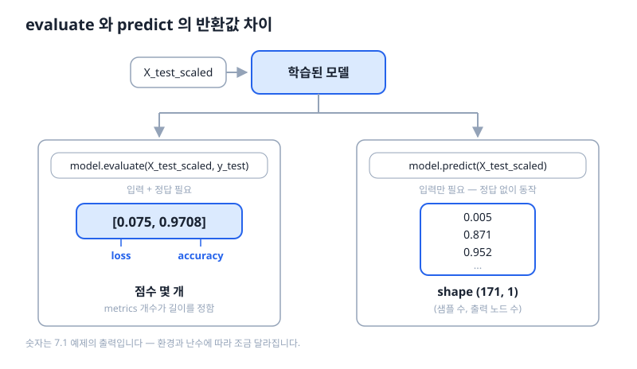
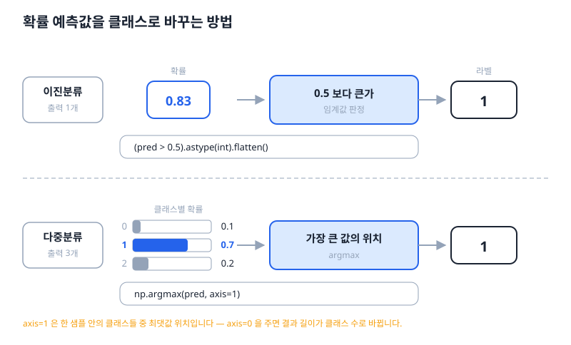
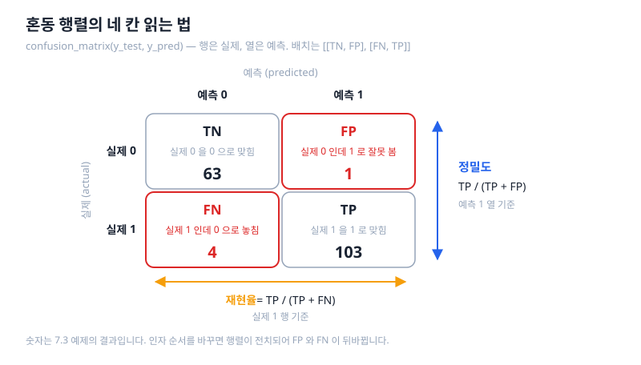
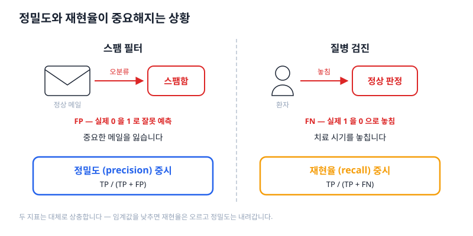
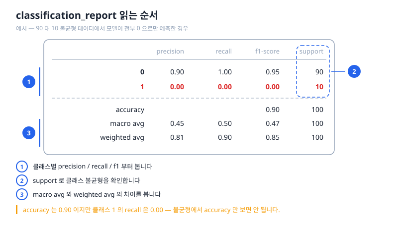
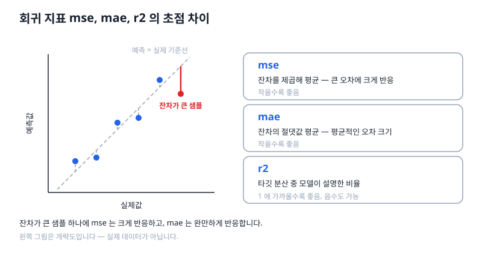

# 7회차 — 평가와 예측

- 범위: 교재 7장 평가와 예측 (https://newids.github.io/dl4aice/ch07.html)
- 발표 35분 안팎 + 질의응답 20분
- 사전 준비: 챕터 읽기 + 실습 셀 풀기

---

## 오늘의 목표

1. `evaluate`와 `predict`가 돌려주는 값의 차이를 설명하고, 문제 유형에 맞게 예측값을 정답과 비교할 수 있는 모양으로 바꾸는 코드를 쓴다.
2. 혼동 행렬과 `classification_report`의 숫자를 서로 계산해 가며 읽는다.
3. 시험 14번 문항 유형인 "새 입력 한 건 예측" 코드를 순서대로 쓴다.

---

## 진행 순서

| 구간 | 내용 | 시간 |
|---|---|---|
| 7.1 | evaluate와 predict | 3분 |
| 7.2 | 확률을 클래스로 바꾸기 | 5분 |
| 7.3 | 혼동 행렬 | 3분 |
| 7.4~7.5 | 정밀도, 재현율, classification_report | 7분 |
| 7.6~7.7 | 회귀 지표와 학습 곡선 | 5분 |
| 14번 유형 | 새 입력 예측과 자주 틀리는 지점 | 5분 |
| 함께 풀기 | 실습 셀 두 개 | 6분 |
| 정리 | 기억할 내용 | 1분 |
| 질의응답 | 토론 질문과 질문 받기 | 20분 |

---

## 7.1 evaluate와 predict의 반환값 (2분)



- `evaluate(X_test_scaled, y_test)`: 정답이 필요하고 `[loss, 지표...]` 리스트를 돌려줍니다.
- `predict(X_test_scaled)`: 입력만 받고 `(샘플 수, 출력 노드 수)` 배열을 돌려줍니다.
- 반환값 개수는 `compile`의 `metrics`가 정합니다.

---

## 7.1 반환값 순서와 확률의 의미 (1분)

```python
loss, acc = model.evaluate(X_test_scaled, y_test, verbose=0)
pred = model.predict(X_test_scaled, verbose=0)
print('predict 결과 shape:', pred.shape)    # (171, 1)
```

- 교재 예시에서 `predict` 결과의 shape는 `(171, 1)`이고, 값은 라벨이 아니라 클래스 1일 확률입니다. 앞 5개는 `[0.005 0.871 0.952 0.002 0.258]`입니다.
- `evaluate`는 항상 loss가 먼저입니다. `acc, loss = ...`로 받으면 오류 없이 값만 바뀝니다.
- `metrics`를 지정하지 않으면 반환값이 loss 하나뿐이라 `loss, acc = ...`가 오류를 냅니다.

---

## 7.2 확률을 클래스로 (3분)



| 문제 유형 | predict shape | 변환 코드 |
|---|---|---|
| 이진분류 | `(N, 1)` | `(pred > 0.5).astype(int).flatten()` |
| 다중분류 | `(N, K)` | `np.argmax(pred, axis=1)` |
| 회귀 | `(N, 1)` | `pred.flatten()` (모양만 정리) |

---

## 7.2 변환 코드와 axis (2분)

```python
binary_pred = np.array([[0.83], [0.12], [0.50], [0.91]])
y_pred_bin = (binary_pred > 0.5).astype(int).flatten()
print(y_pred_bin)            # [1 0 0 1]

y_pred_multi = np.argmax(multi_pred, axis=1)
print(y_pred_multi, y_pred_multi.shape)  # [1 0 2 1] (4,)
wrong = np.argmax(multi_pred, axis=0)
print(wrong, wrong.shape)                # [1 0 2] (3,)
```

- `multi_pred`는 샘플 4개, 클래스 3개짜리 softmax 출력입니다.
- `axis=1`은 한 샘플 안에서 가장 큰 클래스를 찾습니다. `axis=0`이면 길이가 클래스 수가 되어 정답과 길이가 맞지 않습니다.
- 0.50은 `> 0.5`가 아니므로 0이 됩니다.

---

## 7.3 혼동 행렬 (3분)



- `confusion_matrix(y_test, y_pred)`: 행이 실제, 열이 예측이며 배치는 `[[TN, FP], [FN, TP]]`입니다.
- 교재 예시는 `[[63, 1], [4, 103]]`입니다. 맞힌 것은 63 + 103 = 166건이고 166 / 171 = 0.9708이라 `evaluate`의 accuracy와 같습니다.
- `tn, fp, fn, tp = cm.ravel()`은 2x2(이진분류)에서만 됩니다.
- 인자 순서를 바꾸면 행렬이 전치되어 FP와 FN이 바뀝니다.

---

## 7.4 정밀도와 재현율 (3분)



- 정밀도 = TP / (TP + FP): 1이라고 예측한 것 중 진짜 비율입니다.
- 재현율 = TP / (TP + FN): 실제 1 중에서 찾아낸 비율입니다.
- 예시 계산: 정밀도 103 / 104 = 0.990, 재현율 103 / 107 = 0.963입니다.
- 임계값을 낮추면 재현율은 오르고 정밀도는 내려갑니다. 지시가 없으면 0.5를 씁니다.

---

## 7.5 classification_report 읽는 순서 (3분)



1. 클래스별 precision, recall, f1 행을 먼저 봅니다.
2. support로 클래스 불균형을 확인합니다.
3. macro avg(단순 평균)와 weighted avg(support 가중 평균)를 비교합니다.

- 리포트의 숫자는 모두 혼동 행렬 네 칸에서 계산할 수 있습니다.

---

## 7.5 정확도만 보면 놓치는 경우 (1분)

90:10 데이터에서 모델이 전부 0으로 예측한 경우입니다.

| 항목 | 값 |
|---|---|
| accuracy | 0.90 |
| 클래스 1 recall | 0.00 |
| macro avg f1 | 0.47 |

- 정확도만 보면 높지만 찾아야 할 클래스 1을 하나도 찾지 못했습니다.
- "성능을 출력하시오"에는 `evaluate`, `classification_report`, `confusion_matrix`를 함께 `print()`합니다.

---

## 7.6 회귀 지표 (3분)



- mse: 오차를 제곱해 평균합니다. 큰 오차에 민감하고 단위가 제곱입니다.
- mae: 오차 절댓값의 평균이라 "평균 몇 정도 빗나간다"로 읽습니다.
- r2: 1에 가까울수록 좋고, 평균값으로 예측하는 것보다 못하면 음수가 됩니다.
- rmse는 `np.sqrt(mse)`로 구합니다.

---

## 7.6 회귀에서 predict 결과 정리 (1분)

```python
y_pred_reg = reg.predict(Xr_test_scaled, verbose=0).flatten()   # (N,1) -> (N,)
mse = mean_squared_error(yr_test, y_pred_reg)
mae = mean_absolute_error(yr_test, y_pred_reg)
r2 = r2_score(yr_test, y_pred_reg)
```

- `loss='mse'`로 컴파일하면 `evaluate`의 loss와 sklearn의 mse가 같은 값입니다.
- `(N, 1)`과 `(N,)`이 섞이면 잔차 계산이 `(N, N)`이 되거나 DataFrame을 만들 때 `ValueError`가 납니다.
- sklearn 지표 함수는 모두 정답이 먼저입니다.

---

## 7.7 학습 곡선과 fit 재호출 (1분)

- `history.history.keys()`로 키 이름을 먼저 확인합니다. 회귀를 `metrics=['mae']`로 컴파일했다면 키는 `mae`, `val_mae`입니다.
- `fit`은 가중치를 초기화하지 않습니다. 학습을 마친 모델에 다시 `fit`하면 이어서 학습합니다.
- 곡선을 새로 뽑으려면 모델을 새로 만든 뒤 학습합니다.

---

## 14번 유형: 새 입력 한 건 예측 (3분)

학습 때와 같은 전처리를 거치게 하는 다섯 단계입니다. `X`는 학습 특성 표, `scaler`는 학습 데이터로 맞춘 스케일러입니다.

```python
new_data = {'age': 35, 'monthly_fee': 70.0, 'contract': 'month'}
new_df = pd.DataFrame([new_data])
new_df = pd.get_dummies(new_df, columns=['contract'], dtype=int)
new_df = new_df.reindex(columns=X.columns, fill_value=0)
new_scaled = scaler.transform(new_df)
new_pred = model.predict(new_scaled)
print(new_pred[0][0], int(new_pred[0][0] > 0.5))
```

- 새 입력에는 `fit`이나 `fit_transform`을 쓰지 않습니다.
- 다중분류는 `np.argmax`, 회귀는 `new_pred[0][0]` 값 그대로 읽습니다.

---

## 자주 틀리는 지점 (1) 예측값 변환 (1분)

- 확률을 그대로 `classification_report`에 넣으면 `ValueError`가 납니다. `predict` 다음 줄에는 변환 한 줄이 필요합니다.
- `pred.flatten()`만 하고 임계값 판정을 하지 않으면 같은 오류가 납니다. flatten은 모양만 펴 줍니다.
- 이진분류에 `argmax`를 쓰면 한 행에 값이 하나뿐이라 전부 0이 됩니다.
- 다중분류에서 `axis`를 빼거나 0으로 쓰면 길이가 달라집니다.

---

## 자주 틀리는 지점 (2) 평가 함수 인자 (1분)

- `confusion_matrix(y_pred, y_test)`처럼 순서를 바꾸면 오류 없이 FP와 FN이 바뀝니다.
- FP와 FN이 우연히 같으면 뒤바뀐 행렬이 정상 행렬과 똑같이 보입니다. 눈으로 확인할 수 없으므로 `(y_test, y_pred)` 순서를 손에 익힙니다.
- 오류를 하나 고치고 끝내지 않습니다. 앞의 오류에서 멈춘 코드는 뒤의 오류가 실행되지 않아 드러나지 않습니다.
- 결과를 `print()`하지 않으면 채점자가 확인하기 어렵습니다.

---

## 함께 풀기 1 — 예측값 변환과 회귀 지표 (2분)

사이트의 실습 셀 ch07-q4를 열어 함께 풉니다. 발표자는 https://newids.github.io/dl4aice/ch07.html#drills-ch07 에서 해당 셀을 띄우고, 참가자와 함께 라이브로 풉니다.

세 모델의 `predict` 결과가 주어졌습니다. 유형에 맞는 변환 한 줄씩을 채우고 회귀 지표를 계산합니다.

```python
bin_pred = np.array([[0.83], [0.12], [0.50], [0.91], [0.46]])   # Dense(1, 'sigmoid')
multi_pred = np.array([[0.1, 0.7, 0.2], [0.6, 0.3, 0.1], [0.2, 0.2, 0.6],
                       [0.3, 0.5, 0.2], [0.8, 0.1, 0.1]])        # Dense(3, 'softmax')
reg_pred = np.array([[151.2], [74.8], [140.5], [205.9], [134.7]])
y_reg_true = np.array([155.0, 70.0, 145.0, 200.0, 130.0])

y_bin = ___
y_mul = ___
y_reg = ___
print('mse:', round(___, 3))
print('r2 :', round(___, 4))
```

---

## 함께 풀기 2 — 혼동 행렬과 재현율 (2분)

사이트의 실습 셀 ch07-q2를 열어 함께 풉니다. 주소는 https://newids.github.io/dl4aice/ch07.html#drills-ch07 입니다.

정답 `y_test`와 예측 `y_pred`가 주어졌습니다. 인자 순서에 주의해 혼동 행렬과 재현율을 계산합니다. 정상 행렬은 `[[80 20] [10 90]]`입니다.

```python
y_test = np.array([0] * 100 + [1] * 100)
y_pred = np.array([0] * 80 + [1] * 20 + [0] * 10 + [1] * 90)

cm = ___
tn, fp, fn, tp = ___
recall = ___
precision = tp / (tp + fp)
```

---

## 함께 풀기 — 답과 이유 (2분)

**문제 1 (ch07-q4)**

```python
y_bin = (bin_pred > 0.5).astype(int).flatten()     # [1 0 0 1 0]
y_mul = np.argmax(multi_pred, axis=1)              # [1 0 2 1 0]
y_reg = reg_pred.flatten()
```

- mse는 `mean_squared_error(y_reg_true, y_reg)`, r2는 `r2_score(y_reg_true, y_reg)`입니다. 퀴즈 해설의 값은 mse 22.926, r2 0.987입니다.
- 0.50은 초과가 아니므로 0입니다. `axis=1`은 한 샘플 안의 최댓값 위치입니다.

**문제 2 (ch07-q2)**

```python
cm = confusion_matrix(y_test, y_pred)
tn, fp, fn, tp = cm.ravel()
recall = tp / (tp + fn)                            # 90 / 100 = 0.9
```

- 인자 순서를 바꾸면 행렬이 전치되어 같은 식이 0.8182(정밀도 값)를 냅니다.

---

## 정리

- `evaluate`는 `[loss, 지표]`(loss가 먼저), `predict`는 확률이나 예측값 배열입니다.
- 변환 방법은 출력층 모양에 따라 정해집니다. 이진 `(pred > 0.5).astype(int).flatten()`, 다중 `np.argmax(pred, axis=1)`, 회귀 `flatten()`입니다.
- sklearn 평가 함수는 정답이 먼저입니다. 혼동 행렬 배치는 `[[TN, FP], [FN, TP]]`입니다.
- 리포트는 클래스별 행, support, macro avg와 weighted avg 순서로 읽습니다.
- 새 입력은 1행 표, 같은 인코딩, `reindex`, `scaler.transform`, `predict` 순서이고 `fit`은 하지 않습니다.

---

## 다음 회차 준비

- 다음 회차(8회차)는 8장 문제 유형별 완성 코드와 시험장 전략입니다: https://newids.github.io/dl4aice/ch08.html
- 8장을 읽고 실습 셀(ch08-q1 ~ q5)을 풀어 옵니다.
- 7장의 시험장 표준 코드를 이진분류와 회귀로 한 번씩 직접 실행해 봅니다.
- 부록 A(https://newids.github.io/dl4aice/appendix.html)의 "새 입력 한 건 예측" 묶음을 보지 않고 써 봅니다.

---

## 토론 질문

1. 소수 클래스가 중요한 문제(불량 검출 등)에서 임계값을 0.5에서 옮기겠습니까? 시험에서 지시가 없을 때와 실무에서 판단이 어떻게 달라야 합니까?
2. 평가 문항에서 `evaluate`, `classification_report`, `confusion_matrix`를 모두 출력하는 것과 시간이 부족할 때 하나만 출력하는 것 중, 부분 점수 관점에서 어느 쪽이 유리합니까?
3. 14번 문항의 새 입력에서 `reindex` 없이 `get_dummies`만 쓰면 어떤 일이 생깁니까? 컬럼 수가 같아 보여도 안전하지 않은 경우가 있습니까?

---

## 예상 질문과 답 (1)

**Q1.** `evaluate`의 accuracy와 `classification_report`의 accuracy가 다르게 나올 수 있습니까?
답: 같은 데이터와 같은 임계값 0.5를 쓰면 같아야 합니다. 다르다면 변환 과정(임계값, `axis`)이나 `y_test`와 `y_pred`의 길이가 어긋난 것은 아닌지 확인합니다.

**Q2.** 정밀도와 재현율 중 시험에서는 어느 쪽을 봐야 합니까?
답: 지시문이 요구하는 지표를 출력하는 것이 우선이고, 지시가 없으면 리포트 전체를 출력합니다. 스팸 필터는 정밀도, 질병 검진은 재현율처럼 오류의 비용으로 설명할 수 있어야 합니다.

**Q3.** 회귀에서 r2가 0.38이면 모델이 잘못된 것입니까?
답: 교재의 당뇨 데이터는 원래 예측이 어려워 0.38 안팎이 나옵니다. 다만 -4처럼 크게 음수라면 출력층 활성화나 지표 설정 같은 코드 문제를 먼저 의심합니다.

---

## 예상 질문과 답 (2)

**Q4.** 실행할 때마다 accuracy와 혼동 행렬이 조금씩 달라지는데 괜찮습니까?
답: 시드를 고정해도 TensorFlow 연산에는 미세한 비결정성이 남아 값이 달라질 수 있습니다. 교재도 학습에 의존하는 값에는 변동 범위를 적어 두었으므로, 절차를 지켰는지가 중요합니다.

**Q5.** `flatten()`, `ravel()`, `reshape(-1)` 중 무엇을 써도 됩니까?
답: 세 가지 모두 `(N, 1)`을 `(N,)`로 펴는 같은 결과를 냅니다. 시험에서는 손에 익은 하나로 통일하면 됩니다.

**Q6.** 새 입력 한 건에 `scaler.fit_transform`을 쓰면 왜 안 됩니까?
답: 한 건의 평균과 표준편차로 다시 맞추면 학습 때와 전혀 다른 기준의 값이 됩니다. 학습 데이터로 맞춘 스케일러를 그대로 두고 `transform`만 합니다.

**Q7.** 다중분류에서 `ravel()`로 TN, FP, FN, TP를 꺼낼 수 있습니까?
답: 안 됩니다. 행렬이 K x K라 값이 K*K개이므로 표 전체를 출력해 클래스별 행으로 읽습니다.
