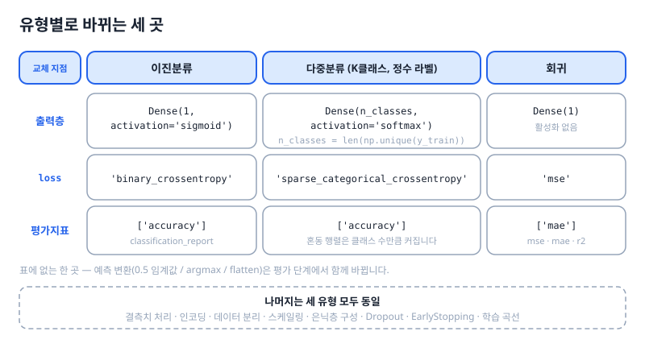
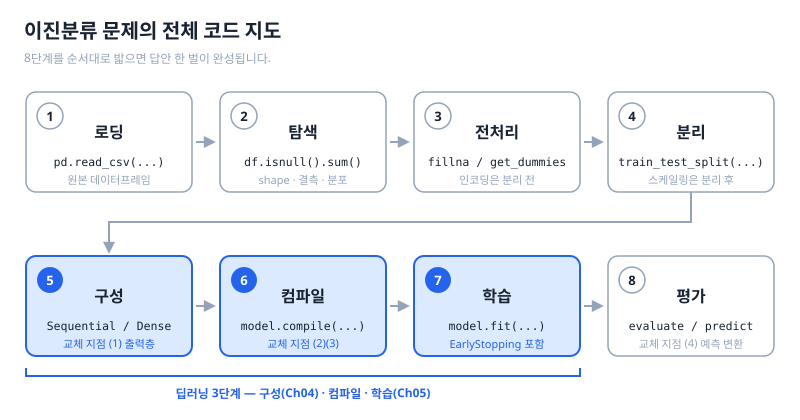
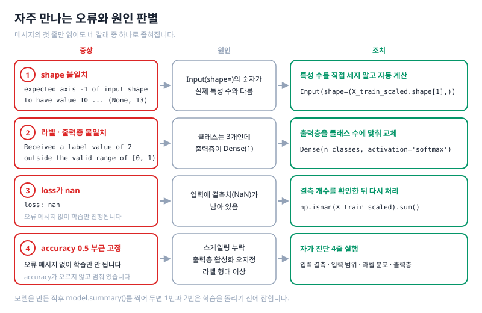
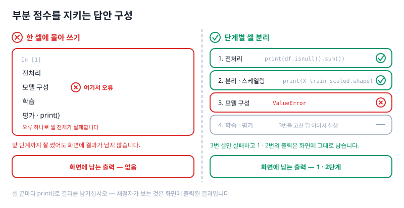

# 8회차 — 문제 유형별 완성 코드와 시험장 전략

- 범위: 교재 8장 문제 유형별 완성 코드와 시험장 전략 (https://newids.github.io/dl4aice/ch08.html)
- 발표 35분 안팎 + 질의응답 20분
- 사전 준비: 챕터 읽기 + 실습 셀 풀기

---

## 오늘의 목표

1. 이진분류, 다중분류, 회귀 코드에서 바꾸는 네 곳(출력층, loss, metrics, 예측 변환)을 짝지어 말하고 교체한다.
2. 오류 메시지의 키워드 하나로 원인을 좁히고, 학습이 안 될 때 자가 진단 4줄을 실행한다.
3. 90분 시간 배분과 제출 전 점검 순서를 자기 계획으로 만든다.

---

## 진행 순서

| 구간 | 내용 | 시간 |
|---|---|---|
| 8.1 | 유형별로 바뀌는 곳 | 4분 |
| 8.2~8.4 | 세 가지 end-to-end 템플릿 | 8분 |
| 8.5 | 오류 대처 방법 | 8분 |
| 8.6~8.7 | 시간 배분, 부분 점수, 제출 전 점검 | 5분 |
| 참고 자료 | 치트시트와 부록 A | 2분 |
| 함께 풀기 | 실습 셀 두 개 | 6분 |
| 정리 | 기억할 내용 | 1분 |
| 질의응답 | 토론 질문과 질문 받기 | 20분 |

---

## 8.1 유형별로 바뀌는 곳 (2분)



- 전처리, 은닉층, `Dropout`, `EarlyStopping`, 학습 곡선은 세 유형에서 같습니다.
- 코드에서 바꾸는 곳은 네 곳입니다: 출력층, loss, metrics, 예측 변환.
- `metrics`는 회귀에서만 바뀌므로 분류끼리 비교하면 세 곳입니다.

---

## 8.1 바뀌는 곳 비교표와 유형 판정 (1분)

| 구분 | 이진분류 | 다중분류 | 회귀 |
|---|---|---|---|
| 출력층 | `Dense(1, 'sigmoid')` | `Dense(K, 'softmax')` | `Dense(1)` |
| loss | `binary_crossentropy` | `sparse_categorical_crossentropy` | `mse` |
| metrics | `['accuracy']` | `['accuracy']` | `['mae']` |
| 예측 변환 | `(pred > 0.5).astype(int).flatten()` | `np.argmax(pred, axis=1)` | `pred.flatten()` |

```python
print(y_train[:10]); print(y_train.dtype); print(len(np.unique(y_train)))
```

- 값 2개는 이진, 정수 3개 이상은 다중, 계속 다른 실수는 회귀입니다.

---

## 자주 틀리는 지점 (1) 출력층과 loss의 짝 (1분)

- loss만 바꾸고 출력층을 그대로 두는 실수가 가장 흔합니다. 반대로 출력층만 바꾸고 loss를 두는 경우도 같습니다. 두 줄은 한 쌍입니다.
- 라벨이 정수면 `sparse_categorical_crossentropy`, 원-핫이면 `categorical_crossentropy`입니다. 출력층은 둘 다 `Dense(K, 'softmax')`입니다.
- 회귀 출력층에 `sigmoid`를 붙이면 예측이 1을 넘지 못해 r2가 크게 음수가 됩니다.
- 회귀에는 `stratify`를 쓰지 않습니다.

---

## 8.2 템플릿 A: 이진분류 end-to-end (3분)



- 8단계: 로딩, 탐색, 결측 처리, 인코딩과 분리와 스케일링, 구성, 컴파일, 학습, 평가.
- 시험에서는 로딩 블록만 `df = pd.read_csv('data.csv')`로 바꿉니다.
- 교재 예시에서 `df.shape`는 `(1000, 5)`인데 입력 특성 수는 6입니다. `get_dummies`가 범주 컬럼 하나를 세 컬럼으로 펼치기 때문이므로 `Input(shape=(X_train_scaled.shape[1],))`로 받습니다.

---

## 8.2 인코딩, 분리, 스케일링의 순서 (2분)

```python
df = pd.get_dummies(df, columns=['contract_type'], dtype=int)
X = df.drop(columns=['churn'])
y = df['churn']
X_train, X_test, y_train, y_test = train_test_split(
    X, y, test_size=0.3, random_state=42, stratify=y)

scaler = StandardScaler()
X_train_scaled = scaler.fit_transform(X_train)
X_test_scaled = scaler.transform(X_test)
```

- 인코딩은 분리 전, 스케일링은 분리 후입니다.
- 모델에 넣는 것은 항상 `_scaled` 배열입니다.
- 평가 데이터에는 `fit` 없이 `transform`만 합니다.

---

## 8.3 템플릿 B: 다중분류에서 바꾸는 곳 (2분)

```python
n_classes = len(np.unique(y_train))
model.add(Dense(n_classes, activation='softmax'))         # (1)
model.compile(optimizer='adam',
              loss='sparse_categorical_crossentropy',     # (2) 원-핫이면 categorical_crossentropy
              metrics=['accuracy'])                       # (3)
y_pred = np.argmax(pred, axis=1)                          # (4)
```

- 와인 데이터(클래스 3개)에서 `predict` 결과는 `(54, 3)`이고 한 행의 합이 1입니다.
- 혼동 행렬은 3x3이므로 `ravel()`로 풀지 않고 표 전체를 출력합니다.
- 클래스 수는 눈으로 세지 않고 `len(np.unique(y_train))`으로 구합니다.

---

## 8.4 템플릿 C: 회귀에서 바꾸는 곳 (1분)

```python
model.add(Dense(1))                                       # (1) 활성화 없음
model.compile(optimizer='adam',
              loss='mse',                                 # (2)
              metrics=['mae'])                            # (3)
y_pred = pred.flatten()                                   # (4)
print('mse:', mean_squared_error(y_test, y_pred))
print('mae:', mean_absolute_error(y_test, y_pred))
print('r2 :', r2_score(y_test, y_pred))
```

- `history` 키가 `mae`, `val_mae`로 바뀝니다. 곡선을 그리기 전에 `history.history.keys()`를 확인합니다.
- `classification_report`는 쓰지 않습니다.

---

## 8.5 오류 대처 방법: 네 가지 증상 (3분)



| 증상 | 원인 |
|---|---|
| shape 불일치 | `Input(shape=)` 숫자와 실제 특성 수가 다름 |
| 라벨 범위 오류 | 클래스 수와 출력층 노드 수가 다름 |
| loss가 `nan` | 입력에 결측치가 남음 |
| accuracy가 0.5 부근 고정 | 스케일링 누락, 출력층 활성화 오지정, 라벨 형태 이상 |

---

## 8.5 메시지 키워드로 원인 좁히기 (2분)

- 메시지가 길어도 키워드 한 개를 먼저 찾습니다.
- `incompatible`이 보이면 입력 shape 문제입니다. 같은 줄의 숫자 두 개, `to have value 10`(모델이 기대한 값)과 `(None, 13)`(실제 입력)를 비교합니다.
- `label value`가 보이면 라벨과 출력층 문제입니다. 예: `Received a label value of 2 which is outside the valid range of [0, 1)`는 클래스 3개에 `Dense(1)`을 쓴 경우입니다.
- `nan`은 오류 메시지가 나지 않습니다. 학습 출력의 `loss: nan`을 직접 보고 알아챕니다.
- 교재의 오류 문구는 Keras 3 기준이며 Keras 2에서는 표현이 다르지만, 숫자 두 개를 비교하는 방법은 같습니다.

---

## 8.5 학습이 안 될 때 자가 진단 4줄 (3분)

```python
print('1. 입력 결측:', np.isnan(X_train_scaled).sum())
print('2. 입력 범위:', X_train_scaled.min().round(2), '~', X_train_scaled.max().round(2))
print('3. 라벨 분포:', np.bincount(y_train))
print('4. 출력층:', model.layers[-1].units, model.layers[-1].activation.__name__)
```

- 1번이 0이 아니면 결측 처리를 빠뜨린 것입니다.
- 2번 범위가 `0 ~ 800`처럼 넓으면 스케일링하지 않은 배열을 넣은 것입니다.
- 3번이 심하게 치우쳤으면 정확도가 의미 없습니다.
- 4번은 이진 `1 sigmoid`, 다중 `K softmax`, 회귀 `1 linear`여야 합니다.
- 모델을 만든 직후 `model.summary()`를 출력해 두면 shape 관련 오류를 미리 알아챌 수 있습니다.

---

## 8.6 시간 배분 (2분)

| 구간 | 배분 | 누적 | 할 일 |
|---|---|---|---|
| 탐색 | 15분 | 15분 | shape, info, value_counts, 결측 확인, 지시된 그래프 |
| 전처리 | 25분 | 40분 | 결측, 인코딩, 분리, 스케일링 |
| 머신러닝 | 15분 | 55분 | 베이스라인 모델과 성능 출력 |
| 딥러닝 | 25분 | 80분 | 판정, 구성, 컴파일, 학습, 평가 |
| 검토 | 10분 | 90분 | 새 코드 없이 재실행과 지시 대조 |

- 교재의 기준 배분이며, 실제 시험의 문항 수와 시간은 회차별로 다를 수 있어 공식 공지를 확인합니다.
- 학습은 먼저 `epochs=20`으로 완주해 평가 출력을 만든 뒤, 시간이 남으면 `epochs=100` + `EarlyStopping`으로 다시 돌립니다.

---

## 8.6 부분 점수를 지키는 답안 구성 (1분)



- 단계마다 셀을 나누고 셀 끝에 `print()`로 결과를 남깁니다.
- 막히면 최소 형태로라도 다음 단계에 넘깁니다. 문제가 되는 컬럼을 `drop`해서라도 진행합니다.
- 지시문의 조건(은닉층 수, `Dropout`, `EarlyStopping`, `random_state=42`)부터 채웁니다.
- 앞 문항의 변수명을 뒤 문항이 이어받으므로 표준 이름을 끝까지 유지합니다.

---

## 8.7 제출 전 최종 점검 (1분)


- 셀을 위에서부터 다시 실행해도 끝까지 도는지 확인합니다.
- 지시된 변수명, `random_state`, `print()` 유무, 저장 파일명(`.keras`)을 대조합니다.
- 마지막 10분에 모델 구조를 바꾸지 않습니다. 재학습이 끝나기 전에 시간이 끝나면 확보한 출력까지 잃을 수 있습니다.

---

## 자주 틀리는 지점 (2) 오류를 만났을 때 (1분)

- 오류가 나면 코드를 처음부터 다시 쓰지 않고 메시지의 키워드를 찾습니다.
- 오류를 보고 `epochs`나 `batch_size`를 조정하지 않습니다. 학습 설정과 무관한 오류가 많습니다.
- 실행이 되었다고 맞은 것이 아닙니다. 회귀에서는 예측값 범위를 실제값 범위와 비교합니다.
- r2가 -4처럼 크게 음수이면 코드 오류를 먼저 의심합니다.
- 스케일러를 두 번 `fit`한 흔적이 없는지 재실행으로 확인합니다.

---

## 치트시트와 부록 A 안내 (2분)

- 치트시트: https://newids.github.io/dl4aice/cheatsheet.html
  - 문제 유형별 비교, 빈출 에러 메시지, 문항별 표준 변수명, 콜백과 신규 샘플 예측, 90분 시간 배분, 제출 전 점검이 한 페이지에 있습니다.
  - 시험은 제한적 오픈북이라고 알려져 있으나 허용 범위는 회차별로 다르므로 공식 공지를 확인합니다.
- 부록 A: https://newids.github.io/dl4aice/appendix.html
  - 외워야 하는 코드를 흐름, 줄, 값 세 단계로 나눠 연습합니다.
  - 첫 셀 임포트부터 새 입력 예측까지 A~I 아홉 묶음이 있습니다.
- 이번 회차 이후 부록 복습 일정에 맞춰 매일 한 묶음씩 보지 않고 써 봅니다.

---

## 함께 풀기 1 — 이진분류 골격을 다중분류로 교체 (2분)

사이트의 실습 셀 ch08-q2를 열어 함께 풉니다. 발표자는 https://newids.github.io/dl4aice/ch08.html#drills-ch08 에서 해당 셀을 띄우고 라이브로 풉니다.

3클래스 와인 데이터입니다. 이진분류 골격에서 바뀌는 곳만 채웁니다. (앞부분의 분리와 스케일링은 생략했습니다.)

```python
n_classes = ___

model = Sequential()
model.add(Input(shape=(X_train_scaled.shape[1],)))
model.add(Dense(64, activation='relu'))
model.add(Dropout(0.3))
model.add(Dense(32, activation='relu'))
model.add(___)

model.compile(optimizer='adam',
              loss=___,
              metrics=['accuracy'])
# ... fit, evaluate ...
pred = model.predict(X_test_scaled, verbose=0)
y_pred = ___
```

---

## 함께 풀기 2 — loss만 바꾸고 출력층을 남긴 코드 (2분)

사이트의 실습 셀 ch08-q4를 열어 함께 풉니다. 주소는 https://newids.github.io/dl4aice/ch08.html#drills-ch08 입니다.

3클래스 와인 분류에서 loss만 `sparse_categorical_crossentropy`로 바꾸고 출력층을 `Dense(1, 'sigmoid')`로 두었더니 `fit()`에서 `label value of 2 ... [0, 1)` 오류가 났습니다. 출력층과 점검 줄을 채웁니다.

```python
n_classes = ___

model = Sequential()
model.add(Input(shape=(X_train_scaled.shape[1],)))
model.add(Dense(64, activation='relu'))
model.add(___)
model.compile(optimizer='adam',
              loss='sparse_categorical_crossentropy',
              metrics=['accuracy'])
print('출력 shape:', ___)

history = model.fit(X_train_scaled, y_train, epochs=10, verbose=0)
```

---

## 함께 풀기 — 답과 이유 (2분)

**문제 1 (ch08-q2)**

```python
n_classes = len(np.unique(y_train))
model.add(Dense(n_classes, activation='softmax'))
loss='sparse_categorical_crossentropy'
y_pred = np.argmax(pred, axis=1)
```

- 바뀌는 곳은 출력층, loss, 예측 변환입니다. `metrics=['accuracy']`는 그대로입니다. `predict shape (54, 3)`과 행 합 1.0으로 교체를 점검합니다.

**문제 2 (ch08-q4)**

```python
n_classes = len(np.unique(y_train))
model.add(Dense(n_classes, activation='softmax'))
print('출력 shape:', model.output_shape)
```

- 출력 노드가 1개이면 허용 라벨 범위가 `[0, 1)`이라 라벨 1, 2가 범위를 벗어납니다. 출력층을 고쳐야 하고 loss는 그대로 둡니다.

---

## 정리

- 유형이 바뀌어도 바꾸는 곳은 출력층, loss, metrics, 예측 변환 네 곳이고 나머지 골격은 같습니다.
- 출력층과 loss는 짝으로 바꾸고, `predict` 다음 줄에는 유형에 맞는 변환 한 줄을 둡니다.
- 오류는 `incompatible`, `label value`, `nan` 같은 키워드로 좁히고, 자가 진단 4줄을 돌립니다.
- 단계별 셀 분리와 셀 끝 `print()`가 부분 점수를 지키는 기본 방식입니다.
- 마지막 10분은 새 코드를 쓰지 않고 재실행과 지시 대조에 씁니다.

---

## 다음 회차 준비

- 다음은 9회차 모의고사 1회 리뷰(이진분류)입니다.
- 모의고사 1회를 90분 타이머를 켠 채 직접 풉니다: https://newids.github.io/dl4aice/mock01.html
- 점수와 틀린 문항 번호를 적어 옵니다. 틀린 이유를 오류 키워드, 변수명, 순서 실수 중 어디에 속하는지 한 줄씩 메모하면 리뷰가 빨라집니다.
- 치트시트와 부록 A로 막힌 부분을 복습하되, 풀이 중에는 시험처럼 필요한 것만 찾아봅니다.

---

## 토론 질문

1. 시간이 부족해 딥러닝 문항에서 `epochs=20`으로 완주한 답안과, 시간을 들여 성능을 올린 미완성 답안 중 어느 쪽이 유리합니까? 근거를 채점 방식에서 찾아 설명해 보십시오.
2. 세 템플릿에서 바꾸는 곳을 외우는 방식과 원리(출력층 활성화와 손실 함수의 관계)를 이해하는 방식은 시험에서 어떻게 다릅니까?
3. 제한적 오픈북이라면 어떤 자료를 열어 보고, 어떤 코드는 반드시 외워서 써야 합니까? 이유와 함께 기준을 정해 봅시다.

---

## 예상 질문과 답 (1)

**Q1.** 다중분류 라벨이 문자열 클래스이면 어떻게 합니까?
답: 교재 템플릿은 정수 라벨을 전제로 하므로, 라벨 인코딩으로 정수로 바꾼 뒤 `sparse_categorical_crossentropy`를 씁니다. 예측 뒤에는 `np.argmax`로 번호를 얻고 `inverse_transform`으로 원래 이름으로 되돌립니다.

**Q2.** 입력 특성 수가 헷갈릴 때 `Input(shape=)`에 숫자를 직접 써도 됩니까?
답: 가능하지만 원-핫 인코딩 뒤의 특성 수는 사람이 세다가 틀리기 쉽습니다. `X_train_scaled.shape[1]`로 받으면 shape 불일치 오류를 처음부터 막을 수 있습니다.

**Q3.** 정확도가 0.7 정도밖에 안 나오는데 코드가 틀린 것입니까?
답: 교재의 합성 이탈 데이터는 원래 어려워 0.7대가 나옵니다. 채점은 점수의 절대값보다 지시한 절차를 지켰는지를 본다고 교재는 설명하므로, 자가 진단 4줄로 코드 오류가 아닌지만 확인합니다.

---

## 예상 질문과 답 (2)

**Q4.** 한 셀에 몰아 쓰면 안 되는 이유가 무엇입니까?
답: 모델 구성에서 오류가 나면 그 셀 전체가 실행되지 않아 앞 단계의 출력도 남지 않습니다. 단계마다 셀을 나누면 오류가 나도 앞 단계 결과가 화면에 남습니다.

**Q5.** `epochs=100`으로 걸어 두고 기다려도 됩니까?
답: 학습 구간이 가장 시간을 잃기 쉬운 곳입니다. 먼저 `epochs=20` 정도로 평가 출력까지 완주해 두고, 시간이 남을 때 `EarlyStopping`과 함께 늘려 다시 실행합니다.

**Q6.** 회귀인데 loss가 `nan`이면 무엇부터 봅니까?
답: 입력에 결측치가 남았는지 `np.isnan(X_train_scaled).sum()`으로 확인합니다. 결측 하나만 있어도 손실이 `nan`이 되고 이후 epoch에서 회복되지 않습니다.

**Q7.** 오류 메시지가 영어로 길게 나오면 어디를 읽습니까?
답: 처음부터 읽지 않고 `incompatible`, `label value`, `expected shape` 같은 키워드가 있는 줄을 찾습니다. 숫자 두 개(기대한 값과 실제 값)를 비교하면 대부분 원인이 드러납니다.
